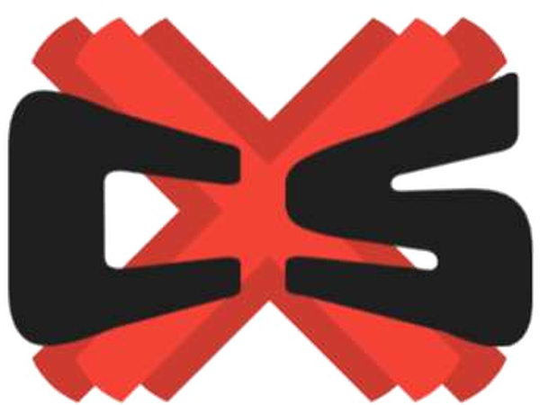

<p align="center"></p>

# CSMAXXXING: AI Overview learning module

**Final version: v3.0 (Stage 3), snapshot of 25 November 2026.** This README, the Markdown in `content/` and the PDF in `dist/` together form the version submitted for assessment. Later commits do not change the submitted assignment.

## Team

| Name | Student ID | Chinese Name | Role | GitHub |
| :--- | :--- | :--- | :--- | :--- |
|Sean Dylan Herlyanto | 1820262084 | 陈家耀 | CEO | sean9secret-png
|Kenji Sukilim | 1820262079 | 林绅宜 | CIO | kenji-sukilim
|Chrysander Hayden Gunawan | 1820262126 | 徐泽豪 |Designer | lexlordne-sys
|Saviero Shioru Dimulia | 1820262033 | 李如意 | CTO | shiorud
|Maxienno Jose Carvallo | 1820262093 | 廖伟斌 | Tester | maxiennojosecarvallo-crypto

## Purpose, learners and goals

An introductory module on artificial intelligence for **first-year university students and other beginners with no AI or programming background**. It explains what AI is and how it works (Ch. 1–2), the types and uses of AI and when *not* to use it (Ch. 3–5), and the three main ways of building intelligent machines: rules (Ch. 6), learning from data (Ch. 7) and learning from rewards (Ch. 8). It ends with how AI learned to find diamonds in Minecraft. Every chapter has a hands-on Lab with feedback. The full list of learning outcomes is in [`content/00-start-here.md`](content/00-start-here.md#outcomes).

## Start here (recommended reading order)

1. [`content/00-start-here.md`](content/00-start-here.md): overview, outcomes, prerequisites, how to use the materials
2. Chapters in order: [`01`](content/01-introduction-to-ai.md) → [`02`](content/02-how-ai-works.md) → [`03`](content/03-types-of-ai.md) → [`04`](content/04-practical-applications.md) → [`05`](content/05-ai-vs-traditional-programming.md) → [`06`](content/06-symbolic-ai.md) → [`07`](content/07-connectionist-ai.md) → [`08`](content/08-behaviourist-ai.md)
3. [`content/09-glossary-and-resources.md`](content/09-glossary-and-resources.md): glossary, supplementary resources, references
4. Do each chapter's Lab in [`activities/ai-lab/index.html`](activities/ai-lab/index.html) as you go.

Prefer a single document? Open [`dist/CSMAXXXING_Readable_Markdown_Content_v3.0.pdf`](dist/CSMAXXXING_Readable_Markdown_Content_v3.0.pdf).

## Folder structure

```
.
├── README.md                 ← you are here
├── CHANGELOG.md              ← what changed in each version (v1 → v2 → v3)
├── content/                  ← THE MARKDOWN SOURCE (single source of truth)
│   ├── 00-start-here.md
│   ├── 01-…08-*.md           ← one file per chapter; answers at the end of each file
│   └── 09-glossary-and-resources.md
├── assets/
│   ├── brand/                ← team logo and mascot "Max" (SVG + PNG)
│   ├── figures/              ← all teaching diagrams and charts (generated by tools/make_figures.py)
│   ├── screenshots/          ← AI Lab and TensorFlow Playground screenshots used in activities
│   └── photos/               ← open-licence sample photos used by the figures
├── activities/
│   ├── ai-lab/index.html     ← CSMAXXXING AI Lab: offline interactive missions for Ch. 1–8
│   ├── code/                 ← Python activities (neuron, three doors, Q-learning)
│   └── prolog/family.pl      ← Prolog knowledge base for Lab 6
├── docs/
│   └── resource-mapping.md   ← where each topic appears in the guide, test bank, slides and videos
├── tools/
│   ├── make_figures.py       ← regenerates assets/figures
│   └── build/                ← Pandoc + Chrome build for the PDFs (style.css, boxes.lua, build_pdfs.py)
└── dist/                     ← rendered PDF of the Markdown content (generated, do not edit by hand)
```

All images are referenced with **relative paths** (`../assets/...` from `content/`), so the Markdown renders correctly on GitHub and in any Markdown viewer after unzipping.

## How to open or run the supporting materials

| Material | How |
|---|---|
| Markdown chapters | Read on GitHub, or open in VS Code / Typora / any Markdown viewer. |
| **AI Lab** | Double-click `activities/ai-lab/index.html`. Works offline in Chrome, Edge, Firefox or Safari. No install or account. Badges are stored only in your own browser. |
| Python activities | Install Python 3, then `cd activities/code` and `python canteen_neuron.py` (or `three_doors_bandit.py`, `diamond_hunt_qlearning.py`). Standard library only. |
| Prolog | Open <https://swish.swi-prolog.org>, create a program, paste `activities/prolog/family.pl`. Or use the Prolog tab in the AI Lab (offline). |
| Rebuild figures | `pip install numpy matplotlib pillow scikit-image`, then `python tools/make_figures.py` |
| Rebuild PDFs | Needs Pandoc 3 and `pip install playwright` + Chrome. Run `python tools/build/build_pdfs.py` from the repository root. |

## Related learning resources (submitted separately)

| Resource | Where |
|---|---|
| Study Guide v3.0 (PDF) and Test Bank (Word) | Assignment *Study Guide and Test Bank (Stage 3)*: `CSMAXXXING_Stage3_FinalStudyGuide_TestBank.zip` |
| PPT slides with presenter notes | Assignment *PPT Slides (Stage 3)*: `CSMAXXXING_Stage3_FinalPPT` |
| Video Tutorials | Assignment *Video Tutorials*; large video files are kept outside GitHub in the team Google Drive folder: <https://drive.google.com/drive/folders/1lsnS5zVKpcZWO3ieUxUFK0_NMUHiegBL> |

See [`docs/resource-mapping.md`](docs/resource-mapping.md) for a topic-by-topic map.

## Version information

- **v3.0 (this version, Stage 3 final):** complete rewrite and expansion in response to Stage 2 feedback. Added 30+ figures and screenshots, a new offline AI Lab with one activity per chapter, Python and Prolog activities, new sections (history, ways of learning, overfitting, functional AI types, language AI, Q-learning, Minecraft case study), and answers moved after each chapter. Details: [`CHANGELOG.md`](CHANGELOG.md).
- v2.0 (Stage 2): Chapters 6–8 added.
- v1.0 (Stage 1): Chapters 1–5.

Earlier versions remain in the Git history of this repository.

## Known limitations

- Video timestamps quoted for external Crash Course videos come from the YouTube versions; the PBS copies are slightly shorter.
- TensorFlow Playground, SWISH, Teachable Machine and the Kahoot challenge are external services that may change or become unavailable. Every required activity has an offline route (the AI Lab, Python files or screenshots), so no core content depends on them. The Kahoot challenge may expire.
- The AI Lab's mission badges use browser storage. In some privacy modes they are not saved; the activities still work.
- Diamond Hunt and Three Doors are simplified teaching models of reinforcement learning, not reproductions of the research systems described in Chapter 8.

## Licence and credits

Team-created text, figures, AI Lab code and mascot: © 2026 CSMAXXXING, for educational use. The AI Lab embeds **Tau Prolog 0.3.4** (BSD-3-Clause; licence in `activities/ai-lab/TAU-PROLOG-LICENSE.txt`). Screenshots of TensorFlow Playground (Apache 2.0). Sample photos from scikit-image (the astronaut image is a public-domain NASA photo). AI assistance used in producing this version is recorded in the team's project log. Full references: [`content/09-glossary-and-resources.md`](content/09-glossary-and-resources.md#references).
