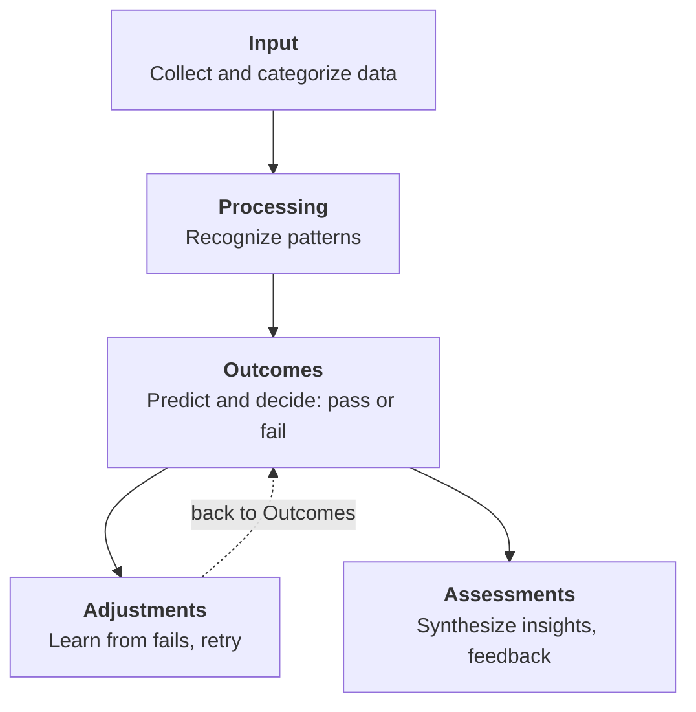
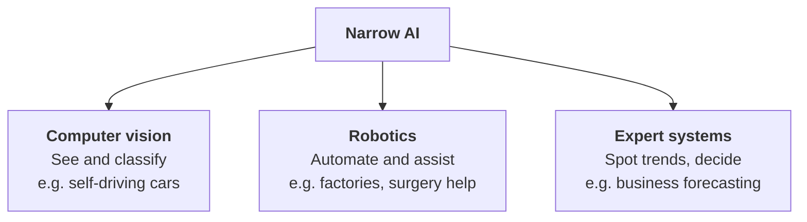

# AI Study Guide

## Table of Contents

1. Introduction to Artificial Intelligence
   - 1.1 Defining AI and its Purpose
   - 1.2 The Societal and Economic Impact of AI
2. The 5-Step Process: How AI Works
   - 2.1 Input: Data Collection & Categorization
   - 2.2 Processing: Pattern Recognition & Sorting
   - 2.3 Outcomes: Predictions & Decision Making
   - 2.4 Adjustments: Learning from Failures
   - 2.5 Assessments: Synthesizing Insights & Feedback Loops
3. Types of AI (Based on Capabilities)
   - 3.1 Artificial Narrow AI (Weak AI) – Present-day Applications
   - 3.2 Artificial General AI (Strong AI) – Theoretical Concepts
   - 3.3 Super AI – Beyond Human Cognition
4. Practical Applications & Technologies
   - 4.1 Computer Vision: Object Detection & Self-Driving Vehicles
   - 4.2 Robotics: Industrial Automation & Healthcare Assistance
   - 4.3 Expert Systems: Data Trends & Complex Problem Solving
5. AI vs. Traditional Programming: Advantages & Disadvantages
   - 5.1 Control and Transparency (The "Black Box" Problem)
   - 5.2 Learning Capability & Unstructured Data Handling
   - 5.3 Stability vs. Scalability
   - 5.4 Efficiency, 24/7 Availability, and Workforce Implications
6. Interactive Activity & Practical Sandbox
   - 6.1 Live Demonstration: Generative AI Tool Showcase
   - 6.2 Knowledge Check: Interactive Review Activity (Kahoot Quiz)

## 1. Introduction to Artificial Intelligence

**1.1 Defining AI and its Purpose**

Artificial intelligence (AI) is a foundational technology that is supercharging other scientific fields and, like electricity and the internet, has the potential to transform societies, economies, and politics worldwide.

**Source:** <https://setr.stanford.edu/technology/artificial-intelligence/2026>
**Authors:** Co-chairs Condoleezza Rice, Jennifer Widom, and Amy Zegart. Director and Editor in Chief Herbert S. Lin. Managing Editor Martin Giles.

**1.2 The Societal and Economic Impact of AI**

The real-world potential of AI is immense. Applications of AI include diagnosing diseases, personalizing social media feeds, executing sophisticated data analyses for weather modeling and powering the chatbots that handle our customer support requests. AI-powered robots can even assemble cars and minimize radiation from wildfires.

*Chrystal R. China, 2024*
**Source:** <https://www.ibm.com/think/insights/artificial-intelligence-advantages-disadvantages>

## 2. The 5-Step Process: How AI Works

Below, we'll go through five steps that illustrate how AI works: inputs, processing, outcomes, adjustments, and assessments.

**2.1 Input: Data Collection & Categorization**

Data is first collected from various sources in the form of text, audio, video, and more. It is sorted into categories, such as those that can be read by the algorithms and those that cannot. You would then create the protocol and criteria for which data will be processed and used for specific outcomes.

**2.2 Processing: Pattern Recognition & Sorting**

Once data is gathered and input, the next step is to allow AI to decide what to do with the data. The AI sorts and deciphers the data using patterns it has been programmed to learn until it recognizes similar patterns in the data that is being filtered into the system.

**2.3 Outcomes: Predictions & Decision Making**

After the processing step, the AI can use those complex patterns to predict outcomes in customer behavior and market trends. In this step, the AI is programmed to decide whether specific data is a "pass" or "fail"—in other words, does it match previous patterns? That determines outcomes that can be used to make decisions.

**2.4 Adjustments: Learning from Failures**

When data sets are considered a "fail," AI learns from that mistake, and the process is repeated again under different conditions. It may be that the algorithm's rules must be adjusted to suit the data set in question or that the algorithm needs slight alteration. In this step, you might return to the outcomes step to better align with the current data set's conditions.

**2.5 Assessments: Synthesizing Insights & Feedback Loops**

The final step for AI to complete an assigned task is assessment. Here, the AI technology synthesizes insights gained from the data set to make predictions based on the outcomes and adjustments. Feedback generated from the adjustments can be incorporated into the algorithm before moving forward.

*Figure 1. The 5-step process of how AI works*

*Coursera Staff, 2026*
**Source:** <https://www.coursera.org/articles/how-does-ai-work>

## 3. Types of AI (Based on Capabilities)

**3.1 Artificial Narrow AI (Weak AI) – Present-day Applications**

Artificial Narrow Intelligence, also known as Weak AI (what we refer to as Narrow AI), is the only type of AI that exists today. Any other form of AI is theoretical. It can be trained to perform a single or narrow task, often far faster and better than a human mind can.

However, it can't perform outside of its defined task. Instead, it targets a single subset of cognitive abilities and advances in that spectrum. Siri, Amazon's Alexa and IBM Watson® are examples of Narrow AI. Even OpenAI's ChatGPT is considered a form of Narrow AI because it's limited to the single task of text-based chat.

**3.2 Artificial General AI (Strong AI) – Theoretical Concepts**

Artificial General Intelligence (AGI), also known as Strong AI, is today nothing more than a theoretical concept. AGI can use previous learnings and skills to accomplish new tasks in a different context without the need for human beings to train the underlying models. This ability allows AGI to learn and perform any intellectual task that a human being can.

**3.3 Super AI – Beyond Human Cognition**

Super AI is commonly referred to as artificial superintelligence and, like AGI, is strictly theoretical. If ever realized, Super AI would think, reason, learn, make judgements and possess cognitive abilities that surpass those of human beings.

The applications possessing Super AI capabilities will have evolved beyond the point of understanding human sentiments and experiences to feel emotions, have needs and possess beliefs and desires of their own.

| Level | Capability | Status |
| :--- | :--- | :--- |
| **Super AI** | Surpasses humans | Theoretical |
| **General AI (AGI)** | Any human intellectual task | Theoretical |
| **Narrow AI** | One task: Siri, Alexa, ChatGPT | Exists today |

*Figure 2. The three kinds of AI based on capabilities*

*IBM Data and AI Team, 2024*
**Source:** <https://www.ibm.com/think/topics/artificial-intelligence-types>

Instructions: Answer all 10 questions. Choose one answer for each multiple-choice question. For
short-answer questions, answer in one or two sentences.
1. Multiple choice: Which type of AI is described as the only type that exists today in the study
guide?

A. Super AI

B. Artificial General Intelligence (AGI)

C. Artificial Narrow AI

D. Artificial Superintelligence

2. Multiple choice: Which statement best describes Artificial Narrow AI (Weak AI)?
   
A. It can perform any intellectual task a human can.

B. It is designed or trained for a single or narrow task.

C. It always surpasses human cognition.

D. It has its own beliefs and desires.

3. Identify the type: A virtual assistant such as Siri or Amazon’s Alexa is given a defined task and
cannot operate beyond that task. Which type of AI is this?

A. Super AI

B. Artificial General Intelligence

C. Artificial Narrow AI

D. None of the above

4. Multiple choice: According to the study guide, why is ChatGPT classified as Narrow AI?
   
A. It can perform every human intellectual task.

B. It is considered limited to text-based chat.

C. It surpasses human cognition in all areas.

D. It possesses independent desires.

5. Short answer: What is Artificial General Intelligence (AGI), and what key ability would it have?
Answer: ________________________________________________________________

6. True or false: Artificial General Intelligence is described in the study guide as a technology that
already exists.
Answer: ________________________________________________________________

7. Scenario: An AI system can use what it has learned to perform new intellectual tasks in different
contexts without humans training the underlying models. Which type of AI does this describe?
Answer: ________________________________________________________________

8. Multiple choice: Which description best matches Super AI?
    
A. It performs only one narrow task.

B. It can perform any intellectual task that a human can.

C. Its cognitive abilities would surpass those of human beings.

D. It is the only type of AI that exists today.

9. Compare: State one difference between Artificial Narrow AI and Artificial General Intelligence
(AGI).
Answer: ________________________________________________________________

10. True or false: Super AI is theoretical and, if realized, would have cognitive abilities that surpass
human beings.
Answer: ________________________________________________________________

ANSWERS

1. C — Artificial Narrow AI.
2. B — It can be trained to perform a single or narrow task and cannot perform outside its defined
task.
3. C — Artificial Narrow AI.
4. B — The study guide describes ChatGPT as limited to the single task of text-based chat.
5. AGI is theoretical and could use previous learnings and skills to accomplish new tasks in different
contexts, and perform any intellectual task that a human can.
6. False — AGI is described as a theoretical concept.
7. Artificial General Intelligence (AGI).
8. C — Its cognitive abilities would surpass those of human beings.
9. Narrow AI is limited to a single or narrow task; AGI would be able to learn and perform any
intellectual task that a human can, including in new contexts.
10. True.

---

## 4. Practical Applications & Technologies

### 4.1 Computer Vision: Object Detection & Self-Driving Vehicles

Narrow AI applications with computer vision can be trained to interpret and analyze the visual world. This allows intelligent machines to identify and classify objects within images and video footage.

Applications of computer vision include:

- Image recognition and classification
- Object detection
- Object tracking
- Facial recognition
- Content-based image retrieval

Computer vision is critical for use cases that involve AI machines interacting and traversing the physical world around them. Examples include self-driving cars and machines navigating warehouses and other environments.

**4.2 Robotics: Industrial Automation & Healthcare Assistance**

Robots in industrial settings can use Narrow AI to perform routine, repetitive tasks that involve materials handling, assembly and quality inspections. In healthcare, robots equipped with Narrow AI can assist surgeons in monitoring vitals and detecting potential issues during procedures.

Agricultural machines can engage in autonomous pruning, moving, thinning, seeding and spraying. And smart home devices such as the iRobot Roomba can navigate a home's interior using computer vision and use data stored in memory to understand its progress.

**4.3 Expert Systems: Data Trends & Complex Problem Solving**

Expert systems equipped with Narrow AI capabilities can be trained on a corpus to emulate the human decision-making process and apply expertise to solve complex problems. These systems can evaluate vast amounts of data to uncover trends and patterns to make decisions. They can also help businesses predict future events and understand why past events occurred.

*Figure 3. Practical applications of Narrow AI*

*IBM Data and AI Team, 2024*
**Source:** <https://www.ibm.com/think/topics/artificial-intelligence-types>

---

## 5. AI vs. Traditional Programming: Advantages & Disadvantages

As with any technology, there are advantages and disadvantages of AI, when compared to traditional programming technologies. Aside from foundational differences in how they function, AI and traditional programming also differ significantly in terms of programmer control, data handling, scalability and availability.

| | Traditional | AI |
| --- | --- | --- |
| **Control** | Full, traceable logic | Black box, hard to explain |
| **Data** | Structured only | Images, video, text |
| **Learning** | Manual updates | Learns from new data |
| **Stability** | Same result every time | May be inconsistent |
| **Scalability** | Needs more code | Scales quickly |
| **24/7 use** | Often needs staff | Runs unattended |

*Figure 4. AI vs. traditional programming at a glance*

**5.1 Control and Transparency (The "Black Box" Problem)**

Traditional programming offers developers full control over the logic and behavior of software, allowing for precise customization and predictable, consistent outcomes. And if a program doesn't behave as expected, developers can trace back through the codebase to identify and correct the issue.

AI systems, particularly complex models like deep neural networks, can be hard to control and interpret. They often work like "black boxes," where the input and output are known, but the process the model uses to get from one to the other is unclear. This lack of transparency can be problematic in industries that prioritize process and decision-making explainability (like healthcare and finance).

**5.2 Learning Capability & Unstructured Data Handling**

Traditional programming is rigid; it relies on structured data to execute programs and typically struggles to process unstructured data. In order to "teach" a program new information, the programmer must manually add new data or adjust processes. Traditionally coded programs also struggle with independent iteration. In other words, they may not be able to accommodate unforeseen scenarios without explicit programming for those cases.

Because AI systems learn from vast amounts of data, they're better suited for processing unstructured data like images, videos and natural language text. AI systems can also learn continually from new data and experiences (as in machine learning), allowing them to improve their performance over time and making them especially useful in dynamic environments where the best possible solution can evolve over time.

**5.3 Stability vs. Scalability**

Traditional programming is stable. Once a program is written and debugged, it will perform operations the exact same way, every single time. However, the stability of rules-based programs comes at the expense of scalability. Because traditional programs can only learn through explicit programming interventions, they require programmers to write code at scale in order to scale up operations. This process can prove unmanageable, if not impossible, for many organizations.

AI programs offer more scalability than traditional programs but with less stability. The automation and continuous learning features of AI-based programs enable developers to scale processes quickly and with relative ease, representing one of the key advantages of AI. However, the improvisational nature of AI systems means that programs may not always provide consistent, appropriate responses.

**5.4 Efficiency, 24/7 Availability, and Workforce Implications**

Rules-based computer programs can provide 24/7 availability, but sometimes only if they have human workers to operate them around the clock.

AI technologies can run 24/7 without human intervention so that business operations can run continuously. Another of the benefits of artificial intelligence is that AI systems can automate boring or repetitive jobs (like data entry), freeing up employees' bandwidth for higher-value work tasks and lowering the company's payroll costs.

It's worth mentioning, however, that automation can have significant job loss implications for the workforce. For instance, some companies have transitioned to using digital assistants to triage employee reports, instead of delegating such tasks to a human resources department. Organizations will need to find ways to incorporate their existing workforce into new workflows enabled by productivity gains from the incorporation of AI into operations.

*Chrystal R. China, 2024*
**Source:** <https://www.ibm.com/think/insights/artificial-intelligence-advantages-disadvantages>

---

## 6. Interactive Activity & Practical Sandbox

**6.1 Live Demonstration: Generative AI Tool Showcase**

What will we produce?

- PowerPoint presentation
- Practical demonstration (Generative AI tool)

**6.2 Knowledge Check: Interactive Review Activity**

What will we produce?

- Interactive activity Ex: Kahoot
