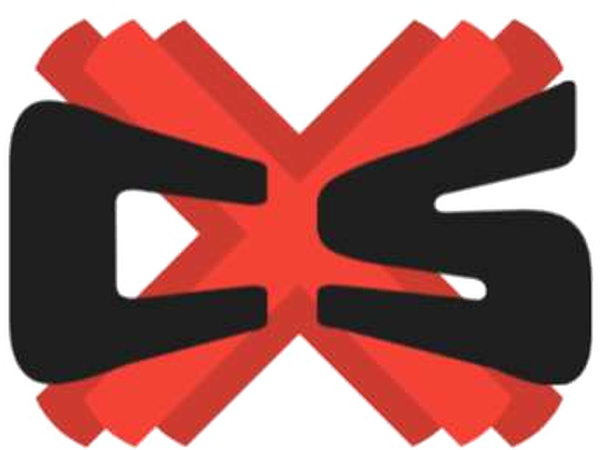
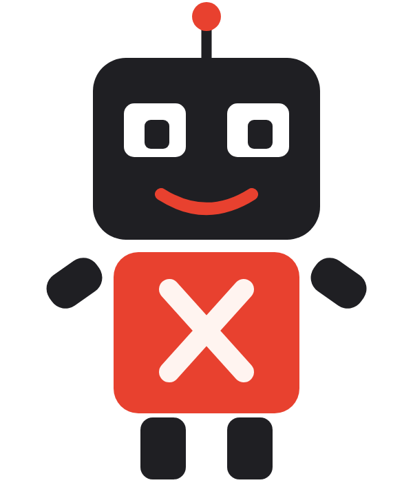

# Start Here: AI Overview {#start-here}

{width=120px}

**Module:** AI Overview (Chapters 1–8) · **Team:** CSMAXXXING · **Version:** 3.0 (Stage 3 final, November 2026)

## What this module is about {#about}

You use artificial intelligence (AI) every day: when your phone unlocks with your face, when a video app picks your next video, when a chatbot answers a question. This module answers three big questions:

1. **What is AI, and how does it work?** (Chapters 1–2)
2. **What kinds of AI exist, where are they used, and when is AI the wrong tool?** (Chapters 3–5)
3. **How do people actually build intelligent machines?** Three different "bets": rules (Chapter 6), learning from data (Chapter 7), and learning from behaviour and rewards (Chapter 8).

The module ends with a real challenge that AI researchers worked on for years: teaching an agent to find **diamonds in Minecraft** with no human help. By then you will know every idea needed to understand how it was done.

{width=90px}

::: max
**Meet Max the Agent.** Max is our mascot and your learning partner. Max starts the module knowing nothing (like a fresh AI model) and learns something in every chapter. Each chapter opens with a **Mission** from Max.
:::

## Who it is for {#learners}

- **Intended learners:** first-year university students and other beginners from any subject.
- **Prerequisites:** none in AI or programming. You need basic arithmetic (adding and multiplying small whole numbers, working out an average) and a web browser.
- **Time:** about 6–8 hours in total, roughly 45–60 minutes per chapter including activities.

## Learning outcomes {#outcomes}

By the end of the module you should be able to:

| # | Outcome | Chapter |
|---|---|---|
| LO1 | Define AI, place machine learning and deep learning inside it, and outline key moments in its history. | 1 |
| LO2 | Explain the five-step process (input, processing, outcomes, adjustments, assessments) and the three main ways machines learn. | 2 |
| LO3 | Classify AI systems by capability (Narrow, General, Super) and by functionality (reactive, limited memory, theory of mind, self-aware). | 3 |
| LO4 | Match real applications to computer vision, robotics, expert systems or language AI. | 4 |
| LO5 | Compare AI with traditional programming and judge when each is the better choice, including the risks. | 5 |
| LO6 | Write and query simple facts and rules, and explain the strengths and limits of symbolic AI. | 6 |
| LO7 | Calculate the output of a simple artificial neuron and explain how a network learns by adjusting weights. | 7 |
| LO8 | Explain behaviour-based robots and reinforcement learning (agent, environment, state, action, reward, policy, exploration). | 8 |

## How to use these materials {#how-to-use}

Each chapter follows the same pattern, so you always know what comes next:

| Label | What it means |
|---|---|
| **MISSION** | A short challenge from Max that gives the chapter its purpose. |
| **KEY IDEA** | The core explanation, with a figure placed right beside it. |
| **MISCONCEPTION** | A common wrong belief, and why it is wrong. |
| **LAB** | A hands-on activity in the **CSMAXXXING AI Lab** or a real online platform. Always **predict first**, then try. |
| **HINT** | A nudge if you are stuck. Hints never give away the answer. |
| **QUICK CHECK** | Two or three short questions to test yourself. |
| **ANSWERS** | Worked answers and feedback are kept in a separate section, *Answers and Feedback*, at the end of the chapter (Markdown) or the end of the Study Guide, so you can try first. |

**Recommended route:** read the Mission → read the Key Ideas → do the Lab (predict, then test) → try the Quick Check → only then check the Answers → watch the chapter's video if anything is still unclear.

## Your toolkit {#toolkit}

| Tool | What it is | Needs |
|---|---|---|
| **CSMAXXXING AI Lab** (`activities/ai-lab/index.html`) | Our own offline web page with one interactive mission per chapter, including a real Prolog engine, a neuron simulator and a reinforcement-learning grid world. | Any modern browser. No internet and no account. Double-click the file to open it. |
| **Python activity files** (`activities/code/`) | Short programs for Chapters 7 and 8 that you can run and modify. | Python 3 (no extra packages), or paste into any online Python editor. |
| **TensorFlow Playground** (playground.tensorflow.org) | A free, open-source neural-network sandbox in the browser, made by Google researchers. | Browser and internet. Screenshots in Chapter 7 act as a fallback. |
| **SWISH** (swish.swi-prolog.org) | The free online SWI-Prolog environment. Optional; the AI Lab's Prolog tab does the same job offline. | Browser and internet. |
| **Test Bank** (separate Word file) | 40 true/false, 40 multiple-choice and 10 open-ended questions with an answer key. | Word or any word processor. |

## Chapter map {#map}

| Chapter | Big question | Lab mission |
|---|---|---|
| 1 Introduction to AI | What is AI, and where did it come from? | AI Spotter |
| 2 How AI Works | How does a machine turn data into decisions? | The Pass-or-Fail Machine |
| 3 Types of AI | Does "an AI that can do anything" exist? | Name That AI |
| 4 Practical Applications | Which AI does which job? | The Smart Warehouse |
| 5 AI vs Traditional Programming | When is AI the wrong tool? | Choose Your Tool |
| 6 Symbolic AI | Can we build intelligence by writing rules? | The Family Detective (Prolog) |
| 7 Connectionist AI | Can a machine learn the rules itself? | The Canteen Neuron + TensorFlow Playground |
| 8 Behaviourist AI | Can a machine learn by doing? | Layer the Vacuum, Three Doors, Diamond Hunt |
