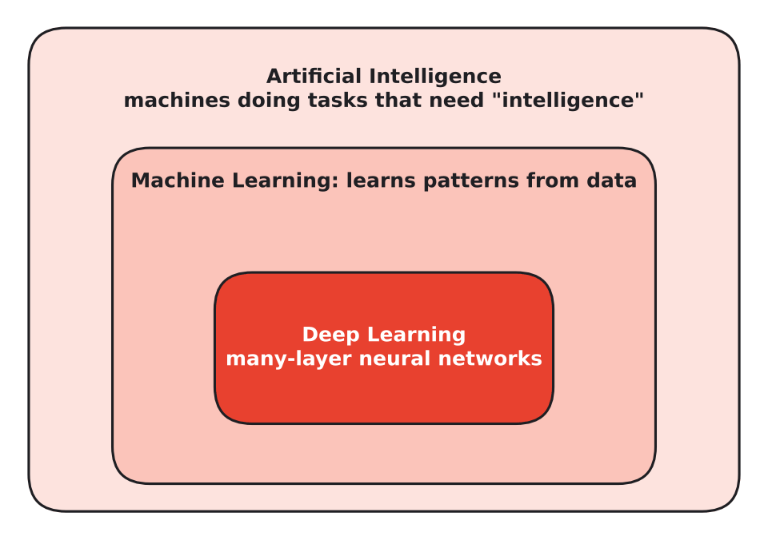
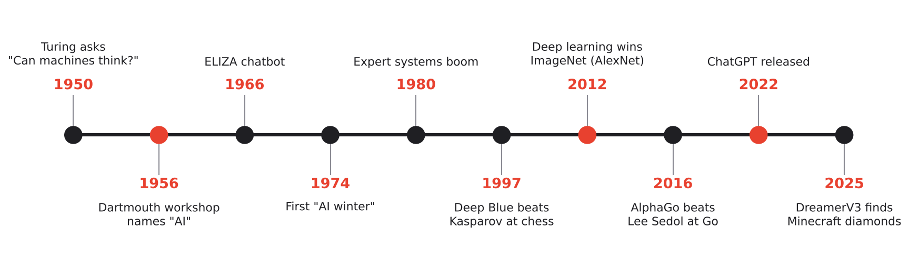
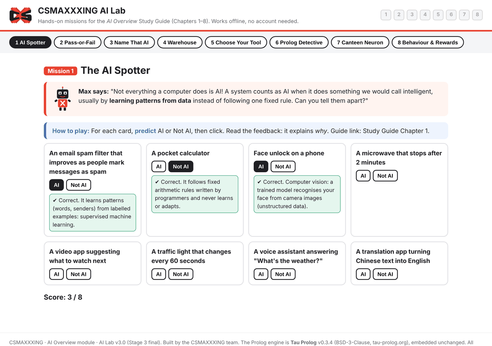

# 1. Introduction to Artificial Intelligence {#ch1}

::: mission
**MISSION 1: The AI Spotter.** Max has been switched on for the first time and wants to know what it is. "Am I AI? Is the calculator next to me AI? Is the traffic light outside AI?" By the end of this chapter you will be able to tell Max what counts as AI, where AI came from, and why people compare it to electricity.
:::

**In this chapter you will:** define AI · see how AI, machine learning and deep learning fit together · walk through 75 years of AI history · weigh up AI's benefits and risks for society.

## 1.1 What is AI? {#ch1-1}

::: keyidea
**Artificial intelligence (AI)** is the ability of a computer system to perform tasks that normally need human intelligence, such as recognising images, understanding language, making decisions or learning from experience.
:::

Two words in that definition matter most:

- **Tasks:** AI is defined by *what it can do*, not by what it is made of. A program that recognises faces is AI; the camera is not.
- **Normally need human intelligence:** adding numbers is easy for any computer, so a calculator is not AI. Recognising your friend's face in a blurry photo is hard to write rules for, so a system that does it is AI.

Most of today's AI works by **learning patterns from data** rather than following rules typed in by a programmer. This idea, called **machine learning**, is the engine behind almost every AI system you use.

{width=70%}

The Stanford Emerging Technology Review describes AI as a **foundational technology**: like electricity and the internet, it boosts many other fields at once and could reshape economies, societies and politics (Stanford SETR, 2026). Electricity did not just power one machine; it changed factories, homes and medicine. AI is spreading in the same way.

::: misconception
**MISCONCEPTION: "AI means robots with feelings."** Today's AI systems are mathematical pattern-finders. They have no consciousness, emotions or self-awareness. A chatbot that writes "I'm happy to help!" is predicting likely words, not feeling happy. Robots are only one place AI appears; most AI runs invisibly inside apps and websites.
:::

## 1.2 A short history of AI {#ch1-2}

AI is older than most people think. Its story has bursts of excitement followed by "winters" when funding dried up because promises were not met.

| Year | Event | Why it matters |
|---|---|---|
| 1950 | Alan Turing asks "Can machines think?" and proposes the *imitation game* (now called the Turing test). | Gave the field its first big question. |
| 1956 | The Dartmouth summer workshop uses the name "artificial intelligence". | AI becomes a research field. |
| 1966 | ELIZA, an early chatbot, imitates a therapist using simple pattern rules. | People believed it understood them, but it did not: an early warning about over-trusting AI. |
| 1970s, late 1980s | "AI winters": funding falls after over-optimistic promises. | Hype has consequences. |
| 1980s | Rule-based **expert systems** spread in business. | Symbolic AI at its peak (Chapter 6). |
| 1997 | IBM's Deep Blue beats world chess champion Garry Kasparov. | Narrow AI can beat the best human at one task. |
| 2012 | A deep neural network (AlexNet) wins the ImageNet image-recognition contest by a wide margin. | The deep learning boom begins (Chapter 7). |
| 2016 | DeepMind's AlphaGo beats Lee Sedol at Go. | Neural networks + reinforcement learning (Chapter 8). |
| 2022 | ChatGPT is released to the public. | Generative AI reaches hundreds of millions of people. |
| 2025 | DeepMind's DreamerV3 learns to collect diamonds in Minecraft from scratch (published in *Nature*). | Reinforcement learning tackles a long, open-ended task (Chapter 8). |

## 1.3 AI's impact on society and the economy {#ch1-3}

AI is already used to diagnose diseases from scans, personalise social-media feeds, model the weather, power customer-support chatbots and guide robots that assemble cars (China, 2024). Its effects cut both ways:

| Benefit | Risk |
|---|---|
| **Productivity:** automates routine work such as data entry, freeing people for higher-value tasks. | **Jobs:** some roles shrink or disappear; workers need retraining (see Section 5.4). |
| **Healthcare:** spots patterns in medical images; speeds up drug discovery. | **Bias:** a system trained on unfair historical data (for example old hiring records) can repeat that unfairness at scale. |
| **Personalisation:** recommendations and interfaces tailored to each person. | **Privacy:** personalisation depends on collecting lots of personal data. |
| **Science:** analyses data sets too large for people to read. | **Digital divide:** the money, computing power and data needed for AI are concentrated in a few companies and countries. |

::: example
**WORKED EXAMPLE: How bias gets in.** Suppose a company trains an AI on 10 years of its own hiring decisions to rank new job applicants. If, in the past, managers mostly hired men for engineering roles, the data contains the pattern "engineer = man". The AI does not know this pattern is unfair; it just learns it and starts ranking women lower. The AI did not invent the bias; it **copied and amplified** a bias that was already in the data. Fixing it means checking the data and the outcomes, not just the code.
:::

## Lab 1: The AI Spotter {#lab1}

::: lab
**Goal:** tell AI apart from ordinary computer programs and explain *why*.

**Open:** the **CSMAXXXING AI Lab** (`activities/ai-lab/index.html`) → tab **1 AI Spotter**. Works offline.

**Steps**

1. Read each of the 8 cards (spam filter, calculator, face unlock, microwave timer and so on).
2. **Predict:** before clicking, say to yourself "AI because…" or "not AI because…".
3. Click **AI** or **Not AI**. A green box means correct; a red box means try again. Read the explanation either way.
4. Reach **8/8** to earn the Mission 1 badge in the top-right corner.

**Reflect:** what did all the "AI" cards have in common? Write one sentence that would help Max sort a new card.
:::

::: hint
**HINT:** Ask two questions about each card. (1) Does the system *perceive* something messy (images, speech, behaviour)? (2) Would it be almost impossible to write one fixed rule for the job? Two "yes" answers usually mean AI.
:::

## Quick check 1 {#qc1}

1. Why is a calculator not AI, even though it is very good at maths?
2. Put these in order from biggest to smallest field: deep learning, AI, machine learning.
3. A hospital trains an AI on 20 years of records in which one group of patients was often under-diagnosed. What risk does this create?

## Key takeaways {#ch1-takeaways}

- AI = computers doing tasks that normally need human intelligence. Most modern AI **learns patterns from data**.
- Deep learning ⊂ machine learning ⊂ AI.
- AI has gone through hype cycles: 1956 (named), 1997 (Deep Blue), 2012 (deep learning), 2022 (ChatGPT).
- AI's benefits (productivity, health, science) come with risks (jobs, bias, privacy, inequality).

**Next:** Max knows *what* AI is. Chapter 2 asks: *how* does it actually turn data into decisions?

## Resources for Chapter 1 {#ch1-resources}

- **CSMAXXXING Video Tutorials, Chapter 1** (team Google Drive folder; link in the Supplementary Resources section). Watch after Lab 1 to hear the definitions explained with examples.
- **Crash Course AI #1, "What Is Artificial Intelligence?"** (CrashCourse with PBS Digital Studios, 2019, about 11 minutes): <https://thecrashcourse.com/courses/what-is-artificial-intelligence-crash-course-ai-1/>. A lively introduction to everyday AI. *While watching:* list two everyday AI examples that are **not** in Section 1.3.
- **Stanford Emerging Technology Review: Artificial Intelligence** (2026): <https://setr.stanford.edu/technology/artificial-intelligence/2026>. A long report for policy readers; read only the AI overview to see the "foundational technology" argument in full.

## Sources for Chapter 1 {#ch1-sources}

- Stanford Emerging Technology Review (2026). *Artificial Intelligence.* <https://setr.stanford.edu/technology/artificial-intelligence/2026>
- China, C. R. (2024). *Artificial intelligence advantages and disadvantages.* IBM. <https://www.ibm.com/think/insights/artificial-intelligence-advantages-disadvantages>
- Turing, A. M. (1950). Computing machinery and intelligence. *Mind*, 59(236), 433–460.
- Hafner, D. et al. (2025). Mastering diverse control tasks through world models. *Nature.* <https://www.nature.com/articles/s41586-025-08744-2>

## Answers and feedback: Chapter 1 {#ch1-answers .answers}

**Lab 1: AI Spotter.** AI: spam filter, face unlock, video recommendations, voice assistant, translation app. Not AI: calculator, microwave timer, fixed-time traffic light. *What the AI cards share:* each one **learns from data** to handle messy inputs (text, images, speech, viewing habits) that no fixed rule could cover. A good sorting sentence: "It's AI if it learned its behaviour from examples instead of following one rule a programmer wrote."

**Quick check 1**

1. A calculator follows fixed arithmetic rules written by programmers. It never learns, and arithmetic does not "normally need human intelligence" in the sense of perception, language or judgement.
2. AI (biggest) → machine learning → deep learning (smallest).
3. The AI may learn the historic under-diagnosis as a pattern and **repeat or amplify it**, so that group keeps being under-diagnosed. This is algorithmic bias; the data and the results must be audited.
