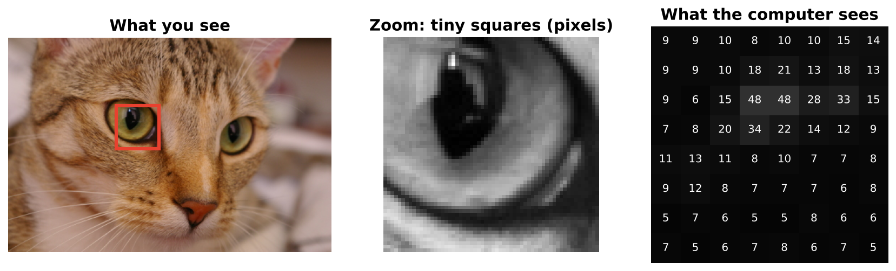
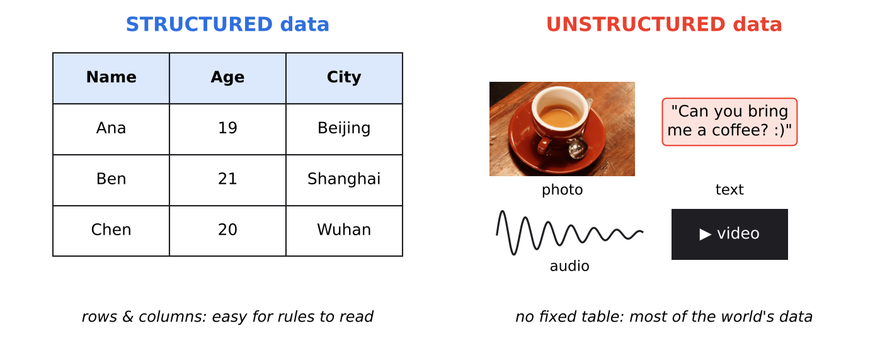
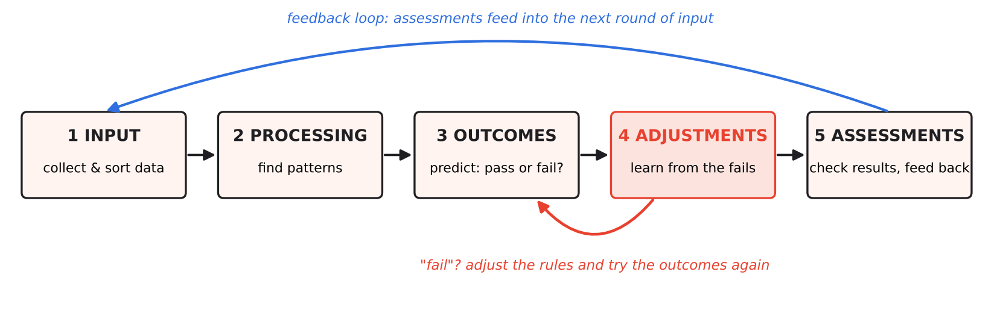
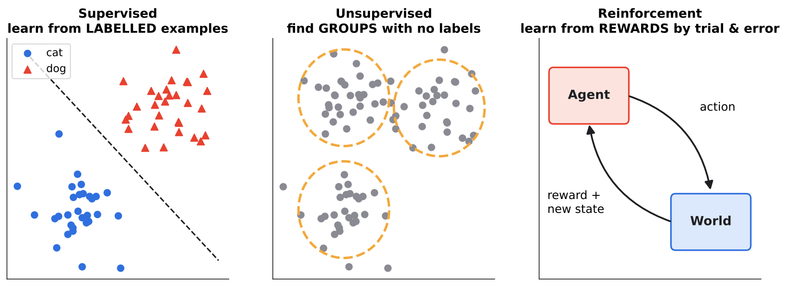
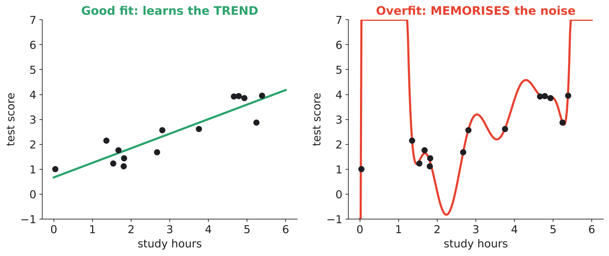
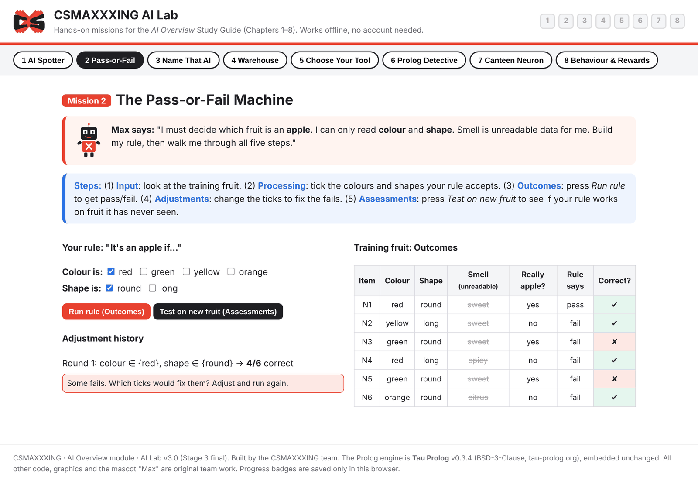

# 2. How AI Works: the Five-Step Process {#ch2}

::: mission
**MISSION 2: The Pass-or-Fail Machine.** Max has a new job at a fruit stall: decide whether each fruit is an apple. Max can see colour and shape but cannot smell. Max will make mistakes. Your mission is to walk Max through the five steps AI systems use, and help Max learn from its failures.
:::

**In this chapter you will:** see what data looks like to a computer · follow the five-step process · meet the three ways machines learn · find out why "perfect on the training data" can still mean "wrong in the real world".

## 2.1 Data: what the computer actually sees {#ch2-1}

AI runs on **data**. To a computer, every photo, sound or sentence is a long list of numbers.

Data comes in two broad kinds:

- **Structured data:** organised in rows and columns, such as spreadsheets and transaction records. Easy for traditional programs.
- **Unstructured data:** photos, video, audio, free text, social-media posts. Hard to write rules for, and this is where AI is most useful.

## 2.2 The five steps {#ch2-2}

Coursera describes how an AI system completes a task in five steps (Coursera Staff, 2026). We use them as the backbone of this module.

| Step | What happens | Fruit-stall example |
|---|---|---|
| **1 Input** | Data is collected (text, audio, video…) and sorted into what the algorithm can read and what it cannot. Criteria are set for which data will be used. | Max records colour and shape. Smell is *unreadable* data, so it is set aside. |
| **2 Processing** | The AI searches the data for patterns it has learned to recognise. | Max notices that the known apples are red and round. |
| **3 Outcomes** | The AI uses the patterns to predict or decide: does new data match ("pass") or not ("fail")? | A new fruit is red and round → "pass: apple". |
| **4 Adjustments** | When results fail, the AI learns from the mistake: the rules or the algorithm are adjusted and the task is tried again. | A green apple was rejected, so Max widens the rule to "red **or** green, and round". |
| **5 Assessments** | The AI checks its overall performance, combines what it learned, and feeds that back into the next round. | Max tests the rule on fruit it has never seen before. |

::: misconception
**MISCONCEPTION: "AI gets it right first time."** No AI does. The *Adjustments* step exists because failures are expected. Every modern AI system is the result of thousands or millions of rounds of failing and adjusting.
:::

## 2.3 Three ways machines learn {#ch2-3}

The Processing and Adjustments steps can happen in three main ways:

| Type | Learns from | Example |
|---|---|---|
| **Supervised learning** | Examples **with the right answer attached** (labels), such as photos marked "cat" or "dog". | Spam filter trained on emails marked spam / not spam. |
| **Unsupervised learning** | Data **without labels**; it finds groups (clusters) by itself. | A shop grouping customers with similar buying habits. |
| **Reinforcement learning** | **Rewards and penalties** from acting in an environment. | A game agent that learns to win (Chapter 8). |

## 2.4 Training, testing and overfitting {#ch2-4}

To know whether an AI has really learned, we split the data:

- **Training data** is used to learn the patterns.
- **Test data** is kept hidden until the end and used to check the AI on examples it has **never seen**.

If an AI scores brilliantly on training data but badly on test data, it has **overfitted**: it memorised the examples (including their random noise) instead of learning the general pattern.

::: example
**WORKED EXAMPLE: A student analogy.** Student A memorises last year's exam answers. Student B learns the method. Both get 100% on last year's paper (training data). On this year's new paper (test data), only Student B does well. Student A *overfitted*. The Assessments step is how we catch this.
:::

## Lab 2: The Pass-or-Fail Machine {#lab2}

::: lab
**Goal:** walk one small example through all five steps, including a failure, an adjustment and a test on new data.

**Open:** CSMAXXXING AI Lab → tab **2 Pass-or-Fail**.

**Steps**

1. **Input.** Look at the six training fruit. Notice the smell column is crossed out: Max cannot read it.
2. **Processing.** The starting rule is "colour is red AND shape is round". **Predict:** how many of the six fruit will it get right?
3. **Outcomes.** Press **Run rule**. Count the ✔ and ✘.
4. **Adjustments.** Change the ticks to fix the ✘ results. Press **Run rule** again. Did you create any new mistakes? Keep going until 6/6.
5. **Assessments.** Press **Test on new fruit**. **Predict first:** will your perfect rule also be perfect on six fruit it has never seen?

**Record:** your rule and score for every round, plus the test score.

**Reflect:** what did the test on new fruit teach you that the training score could not?
:::

::: hint
**HINT:** Look only at the ✘ rows. What do the wrongly rejected apples have in common that the rule does not allow?
:::

**Optional extension (online): Google Teachable Machine** (<https://teachablemachine.withgoogle.com>), a free Google tool that trains an image classifier with your webcam in the browser. Make two classes (for example "thumbs up" and "thumbs down"), record about 30 images of each (**Input**), press *Train* (**Processing**), and try the live preview (**Outcomes**). When it makes mistakes, add more varied images and retrain (**Adjustments**), then test with someone else's hand (**Assessments**). No account is needed for training in the browser; it needs a webcam.

## Quick check 2 {#qc2}

1. In which step does the AI decide "pass" or "fail"?
2. An AI gets 99% on its training data and 60% on new data. What is the likely problem, and which step should catch it?
3. A music app groups songs into "moods" without anyone labelling them. Which type of learning is this?

## Key takeaways {#ch2-takeaways}

- Computers see all data as numbers. Unstructured data (images, text, audio) is where AI is most useful.
- Five steps: **Input → Processing → Outcomes → Adjustments → Assessments**, with feedback loops.
- Three ways to learn: **supervised** (labels), **unsupervised** (no labels, finds groups), **reinforcement** (rewards).
- Always test on unseen data; high training accuracy alone can hide **overfitting**.

**Next:** Max can now learn one job. But could Max ever learn *every* job? Chapter 3 sorts AI into types.

## Resources for Chapter 2 {#ch2-resources}

- **CSMAXXXING Video Tutorials, Chapter 2**: the five steps explained with an animated example.
- **Coursera, "How Does AI Work?"** (2026): <https://www.coursera.org/articles/how-does-ai-work>. The source of the five-step model; read it to compare its wording with our fruit example.
- **Crash Course AI #1** (see Chapter 1). From about 06:00 the video explains that a new AI "knows" nothing and must learn from data. *While watching:* which of the five steps is that learning part of?

## Sources for Chapter 2 {#ch2-sources}

- Coursera Staff (2026). *How Does AI Work?* <https://www.coursera.org/articles/how-does-ai-work>
- IBM (n.d.). *What is machine learning?* <https://www.ibm.com/think/topics/machine-learning>
- Cat photograph: "Chelsea the cat" sample image from the scikit-image library (Stéfan van der Walt), released for reuse with scikit-image.

## Answers and feedback: Chapter 2 {#ch2-answers .answers}

**Lab 2: The Pass-or-Fail Machine.**

- Prediction for "red AND round": **4/6**. It wrongly rejects N3 and N5 (green apples).
- A common first adjustment is "round" only (dropping colour): 5/6, because N6 (an orange) is now wrongly accepted: the adjustment created a new mistake. A rule that scores 6/6 is "colour red **or** green, AND shape round".
- **Test on new fruit:** "red or green, and round" scores **4/6** on the new fruit. It wrongly accepts **T6, a tomato** (red and round) and wrongly rejects **T4, a yellow apple**.
- **Lesson:** a perfect training score does not guarantee good results on new data. Colour and shape are not enough features to separate apples from tomatoes. Real AI needs more features and many more examples, and the Assessments step must always use unseen data.

**Quick check 2**

1. Step 3, **Outcomes**.
2. **Overfitting**: the model memorised the training examples. **Step 5, Assessments** (testing on unseen data) should catch it, and the result feeds back into Adjustments.
3. **Unsupervised learning**: it finds groups without labels.
