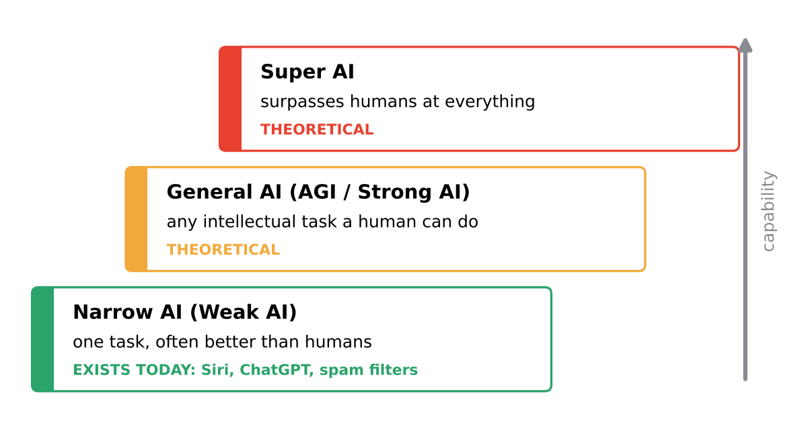
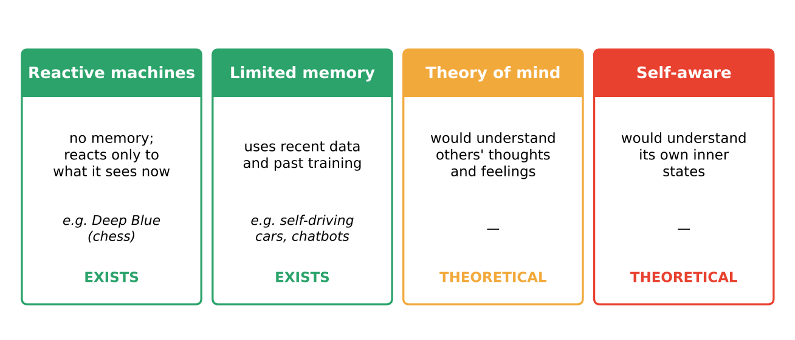
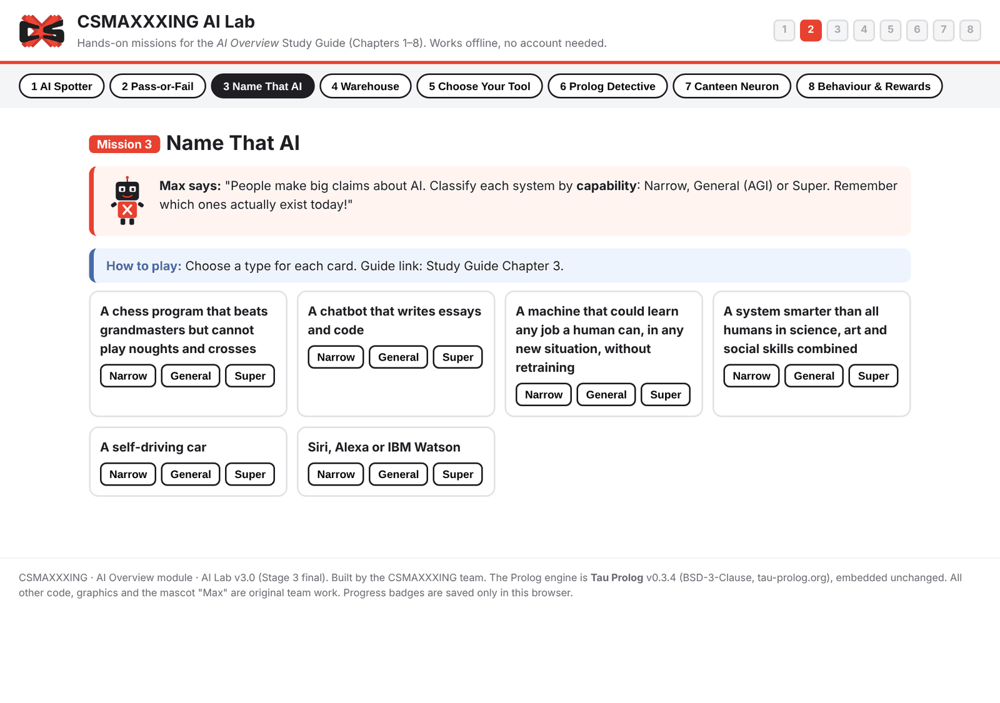

# 3. Types of AI {#ch3}

::: mission
**MISSION 3: Name That AI.** A friend tells Max: "My new app is an AI that can do anything a human can do!" Max is not sure whether to be impressed or suspicious. Your mission: learn the two ways of sorting AI into types, so you can decide what kind of AI that app really is, and whether it can exist today.
:::

**In this chapter you will:** classify AI by **capability** (what it can do) · classify AI by **functionality** (how it uses memory and understanding) · test claims about AI against these definitions.

## 3.1 Types by capability {#ch3-1}

IBM groups AI into three types by capability (IBM Data and AI Team, 2024). Only the first exists today.

{width=85%}

**Narrow AI (also called Weak AI)** is trained to do a single task or a narrow set of tasks, often faster and more accurately than a person. It cannot work outside that task. Siri, Amazon Alexa, IBM Watson and chess programs are Narrow AI. Even ChatGPT is classed as Narrow AI, because it is limited to text-based conversation and relies on learned statistical patterns rather than genuine understanding (IBM Data and AI Team, 2024).

**General AI (Artificial General Intelligence, AGI; also called Strong AI)** would be able to use what it has learned to handle completely new tasks in new situations, without people retraining it: in short, any intellectual task a human can do. It is **theoretical**; no AGI exists.

**Super AI (Artificial Superintelligence)** would think, reason, learn and judge better than humans in every area. It is also **theoretical**. Some writers speculate that it might even have its own needs, beliefs and desires (IBM Data and AI Team, 2024). Because such a system would be beyond human oversight, researchers in **AI safety** study how to keep the goals of advanced AI *aligned* with human values.

::: misconception
**MISCONCEPTION: "ChatGPT is so clever, it must be general AI."** Being impressive is not the same as being general. Chatbots are excellent at one broad task (producing text) but cannot, for example, learn to drive a car or cook a meal from a few minutes of experience as a person can. They are Narrow AI. The word "weak" does not mean "bad": Narrow AI often beats humans *inside* its task.
:::

## 3.2 Types by functionality {#ch3-2}

A second way of sorting AI asks how a system uses **memory** and **understanding**. There are four functional types; the first two sit inside Narrow AI and exist today, while the last two are theoretical (IBM Data and AI Team, 2024).

| Functional type | What it does | Example | Exists? |
|---|---|---|---|
| **Reactive machines** | No memory. Reacts only to what is in front of it now; the same input always gives the same output. | IBM Deep Blue looked at the current chess board and chose a move. | Yes |
| **Limited memory** | Uses recent data and what it learned in training to decide. | A self-driving car tracks the speed and position of nearby cars over the last few seconds. Chatbots also fit here. | Yes |
| **Theory of mind** | Would understand other beings' thoughts, emotions and intentions. | None yet. | No (theoretical) |
| **Self-aware** | Would understand its own internal states, as well as human emotions and thoughts. | None yet. | No (theoretical) |

::: example
**WORKED EXAMPLE: Classifying a robot vacuum.** A basic robot vacuum that turns away whenever its bumper is pressed is a **reactive machine** (no memory) and **Narrow AI** (one task). A newer model that builds a map of your home and remembers which rooms it has cleaned uses **limited memory**, but it is still Narrow AI: it cannot do your homework.
:::

## Lab 3: Name That AI {#lab3}

::: lab
**Goal:** apply the capability definitions to real and imaginary systems.

**Open:** CSMAXXXING AI Lab → tab **3 Name That AI**.

**Steps**

1. For each of the 6 cards, **predict** Narrow, General or Super, then click.
2. Read the feedback. Notice how often the answer is "Narrow".
3. For each card you get right, also say which **functional** type it is (reactive or limited memory).

**Reflect:** Max's friend claims their app "can do anything a human can". Using one sentence from Section 3.1, explain what you would say to them.
:::

## Quick check 3 {#qc3}

1. Which is the only capability type of AI that exists today?
2. A system remembers your last five questions so it can answer a follow-up. Which functional type is this?
3. Why is "Weak AI" a misleading name?

## Key takeaways {#ch3-takeaways}

- **By capability:** Narrow (exists) → General/AGI (theoretical) → Super (theoretical).
- **By functionality:** reactive and limited memory (exist) → theory of mind and self-aware (theoretical).
- Every AI product you can use today, chatbots included, is **Narrow AI**.

**Next:** Narrow AI may be limited to one task, but it is everywhere. Chapter 4 visits the places it works.

## Resources for Chapter 3 {#ch3-resources}

- **CSMAXXXING Video Tutorials, Chapter 3**: the capability ladder with everyday examples.
- **IBM Technology, "The 7 Types of AI – And Why We Talk (Mostly) About 3 of Them"** (YouTube, IBM Technology channel): a short whiteboard video covering both classification systems in this chapter. *While watching:* write down which of the 7 types exist today.
- **IBM, "What is artificial general intelligence (AGI)?"**: <https://www.ibm.com/think/topics/artificial-general-intelligence>. Optional further reading on why AGI is so hard.

## Sources for Chapter 3 {#ch3-sources}

- IBM Data and AI Team (2024). *Understanding the different types of artificial intelligence.* <https://www.ibm.com/think/topics/artificial-intelligence-types>
- Coursera Staff (n.d.). *4 Types of AI: Getting to Know Artificial Intelligence.* <https://www.coursera.org/articles/types-of-ai>

## Answers and feedback: Chapter 3 {#ch3-answers .answers}

**Lab 3: Name That AI.** Chess program: Narrow (reactive). Essay-writing chatbot: Narrow (limited memory). "Any job a human can do, without retraining": General / AGI (theoretical). "Smarter than all humans in everything": Super (theoretical). Self-driving car: Narrow (limited memory). Siri / Alexa / Watson: Narrow (limited memory).
*What to tell Max's friend:* "An AI that can do any intellectual task a human can is AGI, and AGI is still only a theoretical concept, so the app must be Narrow AI that is very good at its particular tasks."

**Quick check 3**

1. Narrow AI (Weak AI).
2. Limited memory.
3. "Weak" only means it is limited to a narrow task. Inside that task, Narrow AI is often faster and more accurate than humans (for example, Deep Blue at chess).
