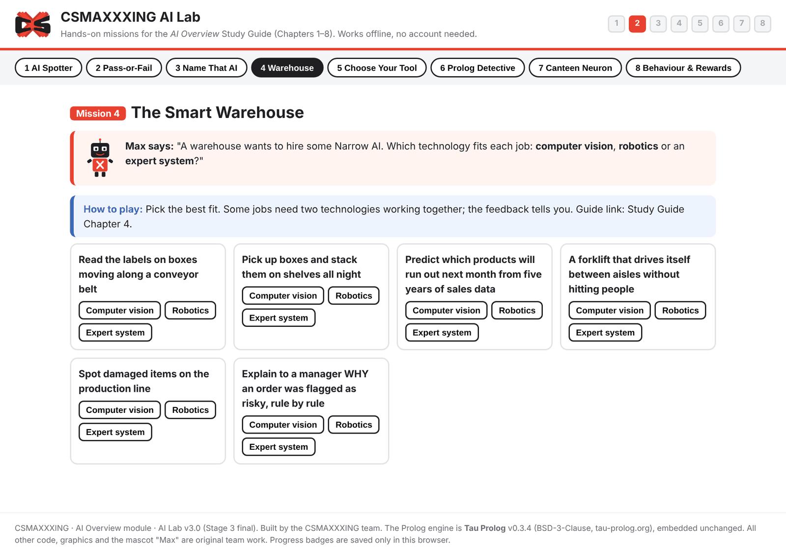

# 4. Practical Applications of AI {#ch4}

::: mission
**MISSION 4: The Smart Warehouse.** A warehouse manager asks Max for help: "I need machines that can *see* the boxes, *move* the boxes, *predict* what we will run out of, and *answer* customers' questions." Each job needs a different kind of Narrow AI. Your mission is to match the right technology to each job.
:::

**In this chapter you will:** see computer vision work on real images · explore robots in factories, hospitals, farms and homes · meet expert systems and language AI · match technologies to jobs.

## 4.1 Computer vision: teaching machines to see {#ch4-1}

**Computer vision** is Narrow AI trained to interpret images and video: to identify and classify what is in them (IBM Data and AI Team, 2024). Its main jobs are:

- **Image classification:** "this photo shows a cat."
- **Object detection:** "there is a face *here*" (with a box around it).
- **Object tracking:** following the same car across video frames.
- **Facial recognition:** "this face belongs to *this* person."
- **Content-based image retrieval:** "find photos that look like this one."

Computer vision is essential whenever a machine has to move through the physical world, such as **self-driving cars** and robots **navigating warehouses** (IBM Data and AI Team, 2024).

## 4.2 Robotics: AI that moves {#ch4-2}

Robots combine sensors, motors and Narrow AI to act in the physical world (IBM Data and AI Team, 2024):

| Setting | What the robot does |
|---|---|
| **Factories** | Repetitive materials handling, assembly and quality inspection. |
| **Hospitals** | Assists surgeons, monitors vital signs and flags possible problems during operations. |
| **Farms** | Autonomous pruning, thinning, seeding and spraying. |
| **Homes** | Robot vacuums such as the iRobot Roomba navigate rooms and remember their cleaning progress. |

Most robots need **computer vision** too: a robot that stacks boxes must first see them.

## 4.3 Expert systems: AI that advises {#ch4-3}

An **expert system** copies the decision-making of a human expert in one specialist area. It is built on a large collection of knowledge and can sift through huge amounts of data to find trends, predict future events and explain why past events happened (IBM Data and AI Team, 2024). Classic expert systems use human-written rules, which is why they can explain their conclusions; you will build one yourself in Chapter 6.

## 4.4 Language AI: AI that reads and writes {#ch4-4}

**Natural language processing (NLP)** is AI that works with human language: spam filters, translation apps, voice assistants and chatbots. **Generative AI**, such as large language models (LLMs) like ChatGPT, goes further: it produces new text (or images) by repeatedly predicting the most likely next piece. Chapter 7 explains the *Transformer*, the network design behind today's LLMs.

::: misconception
**MISCONCEPTION: "A robot that does many jobs must be general AI."** A warehouse robot may lift, sort and scan, but each skill is a narrow, trained task in a known environment. Put it in a kitchen and it is useless. All the applications in this chapter are **Narrow AI** (Section 3.1).
:::

::: example
**WORKED EXAMPLE: One self-driving car, four technologies.** Cameras + **computer vision** detect pedestrians and lane lines. **Robotics** turns decisions into steering and braking. **Limited-memory AI** tracks how nearby cars moved over the last few seconds. **Language AI** lets the passenger say "take me home". Real products usually combine several kinds of Narrow AI.
:::

## Lab 4: The Smart Warehouse {#lab4}

::: lab
**Goal:** match workplace jobs to computer vision, robotics or expert systems, and spot jobs that need more than one.

**Open:** CSMAXXXING AI Lab → tab **4 Warehouse**.

**Steps**

1. Read each of the 6 jobs. **Predict** the technology before clicking.
2. Click your choice and read the explanation.
3. One job accepts two answers. Find it, and explain why both are fair.

**Reflect:** the manager also wants a chatbot that answers customers' delivery questions. Which kind of AI from Section 4.4 is that?
:::

## Quick check 4 {#qc4}

1. Name three jobs computer vision can do.
2. Why does a box-stacking robot usually need computer vision as well as robotics?
3. A system reads 10 years of sales data to predict next month's demand and explains its reasoning. Which technology is it?

## Key takeaways {#ch4-takeaways}

- **Computer vision** sees, **robotics** moves, **expert systems** advise, **NLP / generative AI** reads and writes.
- Real products combine several kinds of Narrow AI.
- None of them is general AI.

**Next:** AI is powerful, but is it always the right choice? Chapter 5 compares it with ordinary programming.

## Resources for Chapter 4 {#ch4-resources}

- **CSMAXXXING Video Tutorials, Chapter 4**: real-world applications with video examples.
- **IBM, "Understanding the different types of artificial intelligence"**: <https://www.ibm.com/think/topics/artificial-intelligence-types>. The source for Sections 4.1–4.3; scroll to the Narrow AI applications.
- **scikit-image gallery** (<https://scikit-image.org/docs/stable/auto_examples/>): the free Python library used to make Figure 4.1. Optional for learners who want to run computer-vision code themselves.

## Sources for Chapter 4 {#ch4-sources}

- IBM Data and AI Team (2024). *Understanding the different types of artificial intelligence.* <https://www.ibm.com/think/topics/artificial-intelligence-types>
- van der Walt, S. et al. (2014). scikit-image: image processing in Python. *PeerJ*, 2, e453. (Face-detection cascade, edge filter and sample images used for Figure 4.1; the astronaut photo is a public-domain NASA image distributed with scikit-image.)

## Answers and feedback: Chapter 4 {#ch4-answers .answers}

**Lab 4: The Smart Warehouse.** Read box labels: computer vision. Stack boxes all night: robotics. Predict stock from sales data: expert system. Self-driving forklift: **computer vision or robotics** (it needs both: vision to see people, robotics to move). Spot damaged items: computer vision. Explain why an order was flagged, rule by rule: expert system.
*Reflection:* a customer chatbot is **language AI (NLP / generative AI)**.

**Quick check 4**

1. Any three of: image classification, object detection, object tracking, facial recognition, content-based image retrieval.
2. It must *see* where the boxes are, how they are rotated and whether anything is in the way before it can move them.
3. An expert system.
