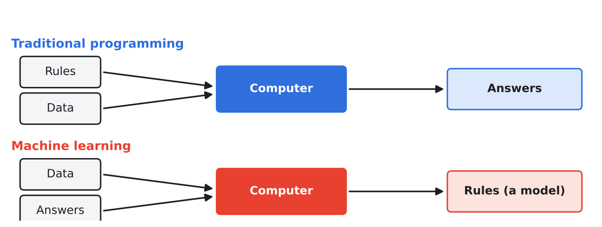
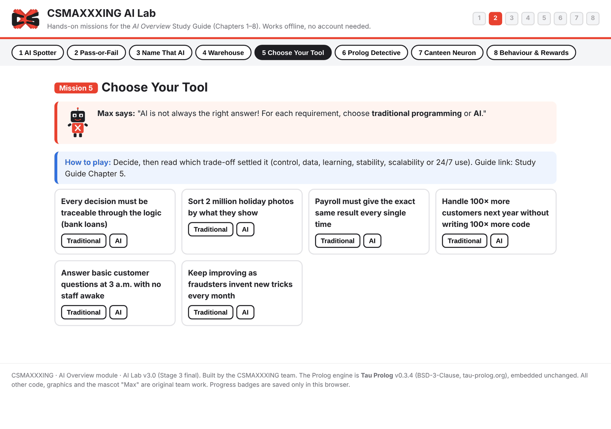

# 5. AI vs Traditional Programming {#ch5}

::: mission
**MISSION 5: Choose Your Tool.** Max is excited: "Let's use AI for everything!" The bank next door disagrees: "Our loan decisions must be explainable to a judge." Your mission is to work out when AI is the better tool, when ordinary programming is, and what can go wrong either way.
:::

**In this chapter you will:** see the key difference in *how* the two approaches produce answers · compare them on six trade-offs · judge which suits a given requirement.

## 5.1 Two ways to get answers {#ch5-1}

In **traditional programming**, a person writes every rule: "IF the amount is over 10,000 THEN ask for a manager." In **machine learning**, the person supplies examples and the computer finds the rules itself. This single difference explains all the trade-offs below.

## 5.2 Six trade-offs {#ch5-2}

The comparison below follows China (2024).

| Trade-off | Traditional programming | AI |
|---|---|---|
| **Control and transparency** | Full control. If something goes wrong, developers can trace the logic line by line. | Often a **"black box"**: we know the input and the output, but not clearly how the model got from one to the other. A problem where explanations are required (healthcare, finance). |
| **Data** | Needs **structured** data; struggles with images, video and free text. | Handles **unstructured** data such as images, video and natural language. |
| **Learning** | Rigid: a programmer must add every new case by hand; unforeseen situations break it. | Learns continually from new data, so it suits changing environments. |
| **Stability** | Very stable: once debugged, it gives the same result every time. | Less stable: its improvised answers may not always be consistent or appropriate. |
| **Scalability** | Hard to scale: more work needs more hand-written code. | Scales quickly through automation and learning. |
| **24/7 availability** | Can run 24/7, but sometimes only with staff to operate it. | Can run 24/7 with no human operator. |

## 5.3 The black box problem {#ch5-3}

A deep neural network may contain millions or billions of weights (Chapter 7). When it rejects a loan, no single weight "contains" the reason, so even its designers may not be able to say *why*. That is acceptable for movie recommendations but serious for medical or legal decisions, where people have a right to an explanation. This is one reason rule-based systems (Chapter 6) are still used.

## 5.4 Efficiency and the workforce {#ch5-4}

AI can take over boring, repetitive work such as data entry, freeing employees for higher-value tasks and cutting payroll costs. The flip side is **job loss**: some companies now use digital assistants to sort (triage) employee reports instead of human resources staff. Organisations need plans to retrain and move their existing workforce into the new workflows that AI creates (China, 2024).

::: misconception
**MISCONCEPTION: "AI is always better than traditional programming."** Each wins on different rows of the table. A payroll system must give the same answer every time and be fully traceable, so traditional code wins. Sorting millions of photos is impossible to write rules for, so AI wins. Good engineers often **combine** them: AI flags a suspicious transaction, and fixed rules decide what happens next.
:::

::: example
**WORKED EXAMPLE: Spam filtering, two ways.** A traditional filter has a rule: "IF the subject contains 'FREE MONEY' THEN spam." Spammers just write "FR33 M0NEY" and the rule fails until a programmer adds another rule. A machine-learning filter learns from millions of emails that users marked as spam, so it picks up new tricks automatically, but it cannot always explain why one particular email was blocked.
:::

## Lab 5: Choose Your Tool {#lab5}

::: lab
**Goal:** decide between traditional programming and AI using the six trade-offs.

**Open:** CSMAXXXING AI Lab → tab **5 Choose Your Tool**.

**Steps**

1. For each of the 6 requirements, **predict** Traditional or AI and name the trade-off row that decides it.
2. Click and compare your reasoning with the feedback.
3. Think of a requirement where **both** rows conflict (for example: "must scale fast *and* be fully explainable").

**Reflect:** for your conflicting requirement, describe a hybrid design that uses both approaches.
:::

## Quick check 5 {#qc5}

1. In one sentence, what is the "black box" problem?
2. Give one advantage of traditional programming and one advantage of AI.
3. What workforce risk does Section 5.4 describe, and what should organisations do about it?

## Key takeaways {#ch5-takeaways}

- Traditional: humans write rules. Machine learning: data + answers → the computer finds rules.
- Traditional wins on **control, transparency and stability**; AI wins on **unstructured data, learning, scalability and 24/7 operation**.
- The black box problem matters most where decisions must be explained.
- Automation creates efficiency **and** workforce disruption.

**Next:** we now look inside the three main *approaches* to building AI. First: what if we simply write down everything an expert knows?

## Resources for Chapter 5 {#ch5-resources}

- **CSMAXXXING Video Tutorials, Chapter 5**: the six trade-offs with examples.
- **IBM, "AI advantages and disadvantages"** (China, 2024): <https://www.ibm.com/think/insights/artificial-intelligence-advantages-disadvantages>. The source of the trade-off table; read the section on the black box.
- **NIST AI Risk Management Framework**: <https://www.nist.gov/itl/ai-risk-management-framework>. The US standards body's guidance on managing AI risks; optional, for learners interested in policy.

## Sources for Chapter 5 {#ch5-sources}

- China, C. R. (2024). *Artificial intelligence advantages and disadvantages.* IBM. <https://www.ibm.com/think/insights/artificial-intelligence-advantages-disadvantages>
- National Institute of Standards and Technology (2023). *AI Risk Management Framework (AI RMF 1.0).* <https://www.nist.gov/itl/ai-risk-management-framework>

## Answers and feedback: Chapter 5 {#ch5-answers .answers}

**Lab 5: Choose Your Tool.** Traceable loan decisions: Traditional (control/transparency). Sort 2 million photos: AI (unstructured data). Same payroll result every time: Traditional (stability). 100× customers without 100× code: AI (scalability). Answers at 3 a.m. with no staff: AI (24/7). Keep up with new fraud tricks: AI (learning).
*Hybrid example:* a bank uses AI to flag unusual transactions quickly at scale, then a rule-based system with traceable rules and a human reviewer make the final, explainable decision.

**Quick check 5**

1. We can see what goes into an AI model and what comes out, but not clearly how it reached the answer.
2. Traditional: full control / traceable / stable (any one). AI: handles unstructured data / learns / scales / runs 24/7 unattended (any one).
3. Automation can cause **job losses** (for example, digital assistants replacing HR staff for triaging reports). Organisations should plan to **retrain and redeploy** existing workers into new AI-enabled workflows.
