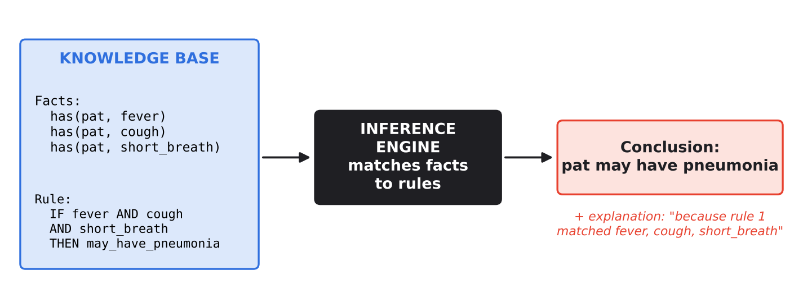
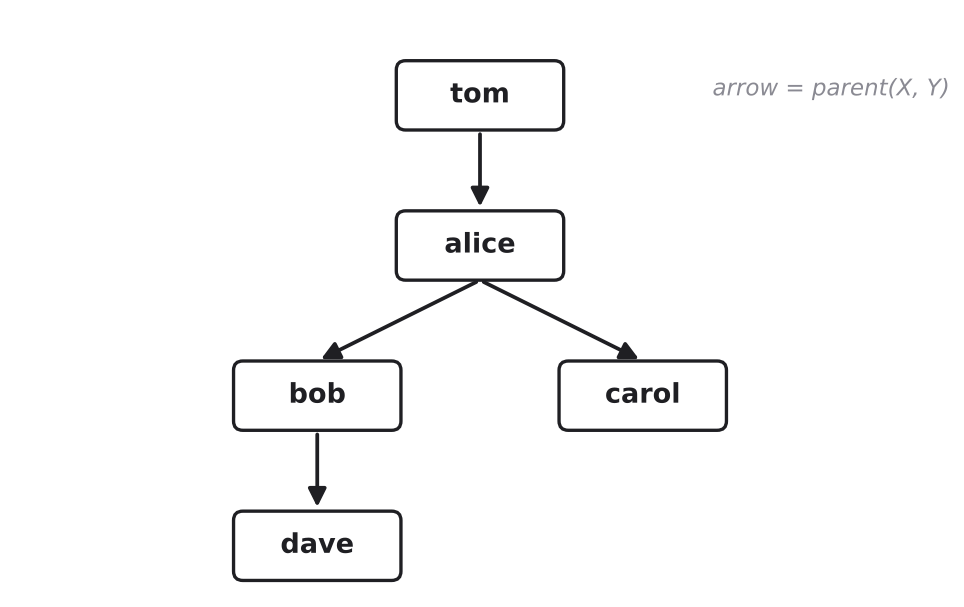
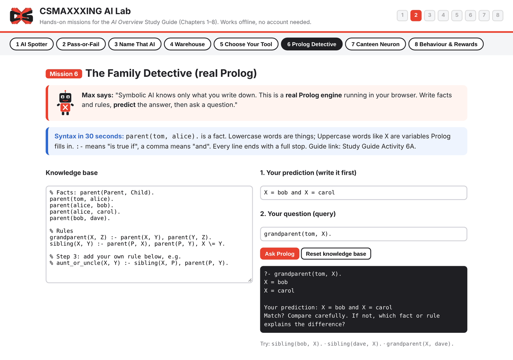

# 6. Symbolic AI: Reasoning with Rules {#ch6}

::: bridge
**Where Chapters 6–8 fit.** Chapters 1–5 told you *what* AI is and where it is used. Chapters 6–8 answer a deeper question: **how do you actually build something that behaves intelligently?** Researchers have made three big bets:

| Approach | The bet | In one line |
|---|---|---|
| **Symbolic AI** (Ch. 6) | Intelligence = reasoning with rules | Humans write the knowledge down; the machine reasons with it. |
| **Connectionist AI** (Ch. 7) | Intelligence = patterns learned from data | A network of simple units adjusts itself from examples. |
| **Behaviourist AI** (Ch. 8) | Intelligence = acting well in the world | Simple behaviours, or rewards, shape what an agent does. |
:::

::: mission
**MISSION 6: The Rulebook Detective.** A small clinic has no training data at all, but it has an experienced doctor. Could Max become useful just by writing down what the doctor knows? And can Max work out family relationships nobody told it directly? Your mission: build a rule-based detective and find out what it can, and cannot, do.
:::

**In this chapter you will:** represent knowledge as facts and rules · see how an inference engine draws conclusions · write and query a real Prolog program · weigh up the strengths and limits of symbolic AI.

## 6.1 What is symbolic AI? {#ch6-1}

**Symbolic AI** represents knowledge with **symbols**, meaning names for objects and ideas, plus the relationships between them, and reasons by applying **logical rules** to those symbols (DataCamp, 2023). Instead of learning from piles of data, a human writes the knowledge down.



Three key terms:

- **Knowledge base:** the collection of facts and rules.
- **Inference engine:** the part that applies rules to facts to reach new conclusions.
- **Expert system:** a symbolic program that gives advice in a specialist area (Section 4.3).

::: example
**WORKED EXAMPLE: Reasoning step by step (forward chaining).**
Facts: *Pat has a fever. Pat has a cough. Pat has difficulty breathing.*
Rule 1: *IF fever AND cough AND difficulty breathing THEN may have pneumonia.*
Rule 2: *IF may have pneumonia THEN recommend a chest X-ray.*
The engine sees that all three conditions of Rule 1 are facts → adds the new fact "Pat may have pneumonia". That new fact now matches Rule 2 → adds "recommend a chest X-ray". Asked "why?", it can reply: "Rule 2, because Rule 1 matched fever, cough and difficulty breathing." (A teaching example only, not medical advice.)
:::

## 6.2 Prolog: a language for rules {#ch6-2}

**Prolog** ("programming in logic") is a language built for symbolic AI. You do not tell it *how* to find an answer; you give it facts and rules and ask questions.

```prolog
parent(tom, alice).            % fact: tom is a parent of alice
grandparent(X, Z) :- parent(X, Y), parent(Y, Z).
% rule: X is a grandparent of Z IF X is a parent of some Y AND Y is a parent of Z
```

- Lowercase words (`tom`, `alice`) are specific things.
- Words starting with a capital letter (`X`, `Y`) are **variables** that Prolog fills in.
- `:-` means "is true if"; a comma means "and"; every statement ends with a full stop.
- A question (query) starts with `?-`, for example `?- grandparent(tom, X).`

{width=55%}

## 6.3 Strengths and limits {#ch6-3}

| Strengths | Why |
|---|---|
| **Explainable** | Every conclusion can be traced to the exact rules used. |
| **Easy to edit** | Change one rule and the behaviour changes immediately. |
| **Needs little data** | Knowledge comes from people, not from thousands of examples. |

| Limits | Why |
|---|---|
| **Needs complete, well-defined knowledge** | If a rule is missing or wrong, the system fails, often silently. |
| **Hard to scale** | Thousands of interacting rules become slow and hard to maintain. |
| **Poor with uncertainty** | It wants precise facts; the messy real world (a blurry photo, a vague symptom) is hard to express as symbols. |
| **Limited learning** | It usually has to be updated by hand. |

(DataCamp, 2023)

::: misconception
**MISCONCEPTION: "Symbolic AI is old, so it is useless."** Rule-based reasoning is still used wherever explanations matter (tax software, safety checks, many business rules), and modern **hybrid** systems combine rules with learning (DataCamp, 2023).
:::

## Lab 6: The Family Detective {#lab6}

::: lab
**Goal:** see conclusions follow from facts and rules, and discover why rules must state everything precisely.

**Open:** CSMAXXXING AI Lab → tab **6 Prolog Detective** (a real Prolog engine, offline). *Alternative:* SWISH at <https://swish.swi-prolog.org> → *Program* → paste the file `activities/prolog/family.pl`.

**Steps**

1. Read the knowledge base (it matches Figure 6.2).
2. For each query below, **write your prediction in box 1 first** (the Lab will not run without one), then type the query in box 2 and press **Ask Prolog**.
   a. `grandparent(tom, X).`  b. `grandparent(alice, X).`  c. `sibling(bob, X).`  d. `sibling(dave, X).`
3. **Extend it.** In the knowledge base, remove the `%` in front of the `aunt_or_uncle` rule. Predict, then ask `aunt_or_uncle(carol, X).`
4. **Break it on purpose.** Delete `, X \= Y` from the `sibling` rule (keep the final full stop). Ask `sibling(bob, X).` again. What changed, and why?

**Stretch:** add `parent(dave, emma).` Predict *all* answers to `grandparent(X, emma).` before you run it.
:::



::: hint
**HINT for step 4:** In the broken rule, can the two `parent(P, …)` lines match the *same* child?
:::

## Quick check 6 {#qc6}

1. What are the two parts of a knowledge base?
2. Give one reason a hospital might prefer a symbolic system over a neural network for some decisions.
3. Why would a symbolic system struggle to recognise cats in photos?

## Key takeaways {#ch6-takeaways}

- Symbolic AI = **facts + rules + inference engine**. Humans supply the knowledge.
- Its superpower is **explainability**; its weakness is that it knows **only what it is told**, precisely.
- Prolog lets you state facts and rules and ask questions.

**Next:** nobody can write rules for "what a cat looks like". Chapter 7 lets the machine learn its own rules from examples.

## Resources for Chapter 6 {#ch6-resources}

- **CSMAXXXING Video Tutorials, Chapter 6**: a walkthrough of Lab 6.
- **SWISH, SWI-Prolog for SHaring** (<https://swish.swi-prolog.org>, University of Amsterdam / SWI-Prolog project): a free online Prolog environment. According to its documentation it runs in a safe sandbox and does not require a login by default. Check that it opens on your network before class; the AI Lab is the offline fallback.
- **Crash Course AI #10, "Symbolic AI"** (CrashCourse with PBS Digital Studios, 2019, about 13 minutes): <https://www.pbs.org/video/symbolic-ai-10-tfkalm>. *While watching:* how is the video's "knowledge base" like the facts and rules you typed in Lab 6?

## Sources for Chapter 6 {#ch6-sources}

- DataCamp (2023). *What is Symbolic AI?* <https://www.datacamp.com/blog/what-is-symbolic-ai>
- SWISH documentation. <https://swish.swi-prolog.org/pldoc/doc/swish/index.html>
- Tau Prolog (v0.3.4, BSD-3-Clause), the open-source Prolog engine embedded in the AI Lab. <http://tau-prolog.org>

## Answers and feedback: Chapter 6 {#ch6-answers .answers}

**Lab 6: The Family Detective** (all answers checked by running them in Tau Prolog).

- a. `grandparent(tom, X).` → `X = bob`, `X = carol` (tom → alice → bob/carol).
- b. `grandparent(alice, X).` → `X = dave`.
- c. `sibling(bob, X).` → `X = carol`.
- d. `sibling(dave, X).` → `false`. Dave's parent bob has no other children.
- Step 3: `aunt_or_uncle(carol, X).` → `X = dave` (carol's sibling is bob, and bob's child is dave).
- Step 4: without `X \= Y`, `sibling(bob, X).` → `X = bob` **and** `X = carol`. Bob counts as his own sibling, because both `parent(alice, …)` goals can match the same child. The rule was logically valid but **incomplete**: it did not say what we assumed. Symbolic AI only knows exactly what you tell it.
- Stretch: with `parent(dave, emma).` added, `grandparent(X, emma).` → `X = bob` only (bob → dave → emma).

**Quick check 6**

1. **Facts** and **rules**.
2. It is **explainable**: every decision can be traced to specific rules, which matters for safety and accountability. (Also: little data needed, easy to update a rule.)
3. Cats look different in every photo (pose, light, breed). Nobody can write precise symbolic rules for all of that pixel variation; symbolic AI is poor with messy, uncertain data.
