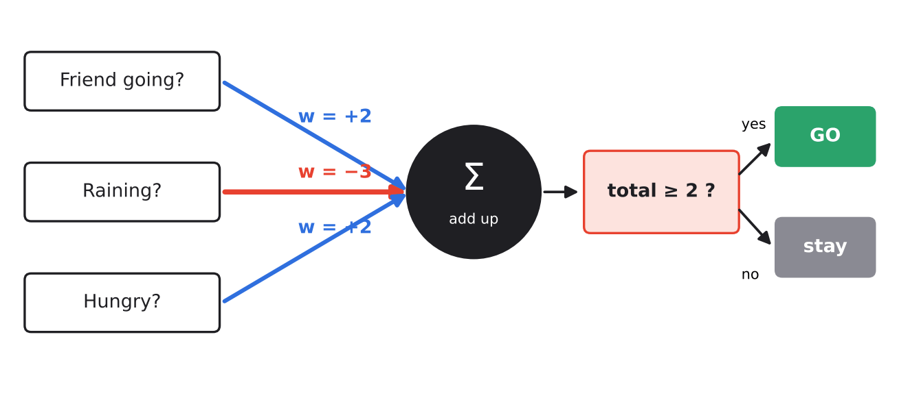
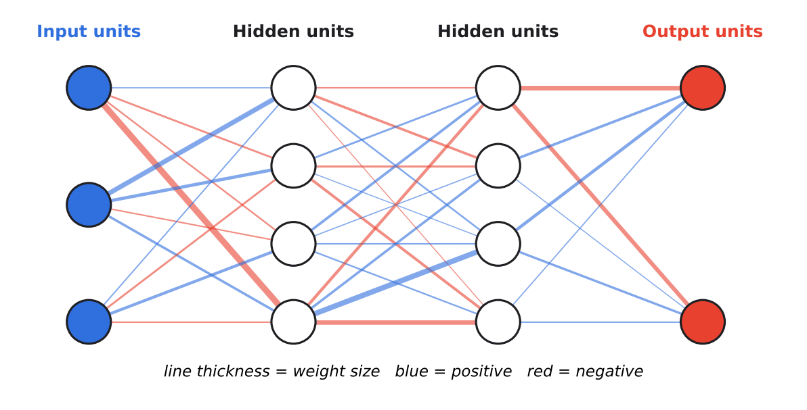
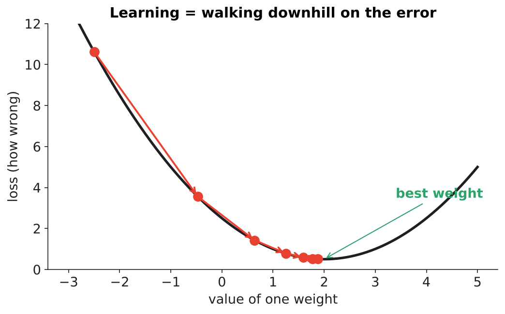
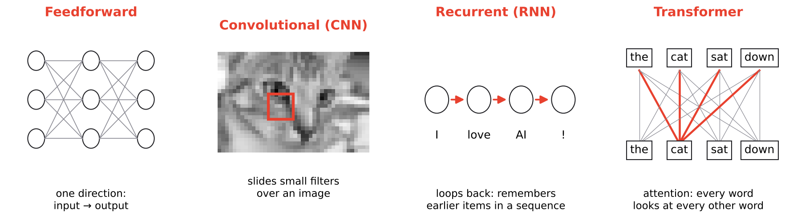
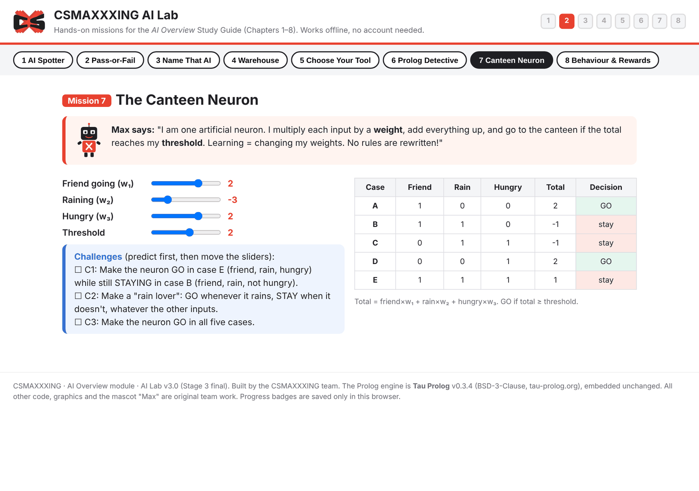
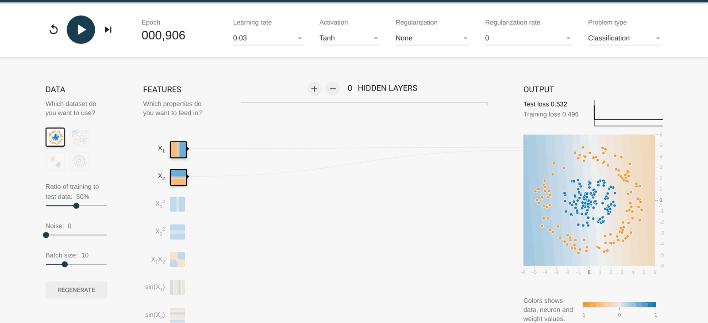
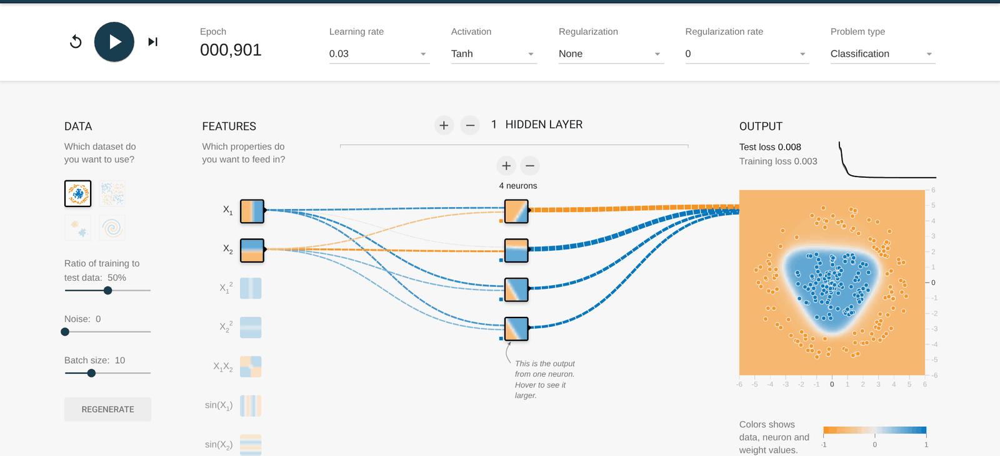
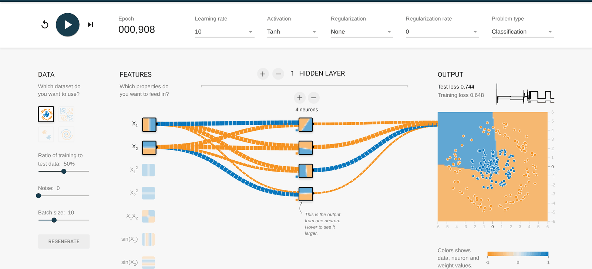

# 7. Connectionist AI: Learning from Data {#ch7}

::: mission
**MISSION 7: The Canteen Neuron.** Nobody can write rules for "what a cat looks like in a photo". So Max tries something new: instead of being *told* rules, Max will become a network of tiny calculators that adjust themselves from examples. Your mission: be one of those calculators, then watch a whole network learn.
:::

**In this chapter you will:** calculate the output of an artificial neuron · see how layers form a network · understand learning as adjusting weights to reduce error · experiment with a real neural network in the browser · meet four network families.

## 7.1 What is connectionism? {#ch7-1}

**Connectionism** explains intelligent behaviour with **artificial neural networks**: many simple units (loosely inspired by brain cells) joined by connections (Stanford Encyclopedia of Philosophy, n.d.). Each connection has a **weight**, a number saying how strongly one unit influences the next. Weights can be **positive** (encourage) or **negative** (discourage).

## 7.2 One artificial neuron {#ch7-2}

A single unit does three things: **multiply** each input by its weight, **add** the results, and **decide** by comparing the total with a threshold.

::: example
**WORKED EXAMPLE: Case B.** Your friend is going (1), it is raining (1), you are not hungry (0).
Total = 1 × (+2) + 1 × (−3) + 0 × (+2) = 2 − 3 + 0 = **−1**. Since −1 < 2, the decision is **stay**.
Now "train" the neuron by changing the rain weight from −3 to −1: total = 2 − 1 + 0 = **1**, still below 2, so still **stay**. But in case E (all three inputs = 1) the total becomes 2 − 1 + 2 = **3**, which is **GO**. Behaviour changed and **no rule was rewritten**: only a number changed.
:::

::: misconception
**MISCONCEPTION: "Artificial neurons work like real brain cells."** They are *inspired by* the brain, but an artificial "neuron" is just a small calculation (multiply, add, compare). A real brain cell is a living cell with complex chemistry. Neural networks are far simpler than brains.
:::

## 7.3 From one neuron to a network {#ch7-3}

Units are arranged in **layers** (Stanford Encyclopedia of Philosophy, n.d.):

- **Input units** receive the data (for example, the pixel numbers from Figure 2.1).
- **Hidden units** sit in between and combine signals into more useful features.
- **Output units** hold the result (for example, "cat" or "dog").

{width=80%}

A network with many hidden layers is a **deep** neural network: that is where "deep learning" (Figure 1.1) gets its name.

## 7.4 How does a network learn? {#ch7-4}

Learning means finding good weights. It links directly to the Adjustments step in Chapter 2:

1. The network makes a prediction on a training example.
2. A **loss** (error) number measures how wrong it was.
3. **Backpropagation** works out, for every weight, which direction of change would reduce the loss.
4. Each weight is nudged a small amount in that direction. The size of the nudge is set by the **learning rate**.
5. Repeat for thousands or millions of examples.

{width=75%}

If the learning rate is **too large**, the steps overshoot and the loss jumps around; **too small**, and learning is very slow.

## 7.5 Symbolic vs connectionist {#ch7-5}

| | Symbolic AI (Ch. 6) | Connectionist AI (Ch. 7) |
|---|---|---|
| Knowledge comes from | Humans writing rules | Patterns learned from data |
| Explains its answers? | Usually yes | Often hard (the black box, Section 5.3) |
| Needs lots of data? | No | Usually yes |
| Good at | Logic, structured knowledge | Perception: images, speech, language |

## 7.6 Four families of neural network {#ch7-6}

| Network | Key idea | Typical use |
|---|---|---|
| **Feedforward** | Information flows one way: input → hidden → output; each layer's output feeds the next (IBM, n.d.-a). | Simple classification and prediction. |
| **Convolutional (CNN)** | Slides small filters across an image to detect edges, then shapes, then objects (IBM, n.d.-a). | Image recognition and computer vision (Chapter 4). |
| **Recurrent (RNN)** | Loops back so it can use earlier items in a sequence (IBM, n.d.-b). | Speech, time series, older translation systems. |
| **Transformer** | Uses **self-attention**: every part of the input can directly "look at" every other part to find relationships (IBM, n.d.-c). | Large language models such as ChatGPT. |

## Lab 7A: The Canteen Neuron {#lab7a}

::: lab
**Goal:** feel how weights and a threshold control a neuron's decisions.

**Open:** CSMAXXXING AI Lab → tab **7 Canteen Neuron**. *Code version:* `activities/code/canteen_neuron.py`. Run it with Python 3, change the numbers at the top, and run it again.

**Steps**

1. With the starting weights (+2, −3, +2, threshold 2), **work out cases A–E on paper first**, then compare with the table.
2. Complete the three **challenges** in the blue box. For each, **predict** which slider to move before touching it. The box turns green when you succeed.
   - **C1:** GO in case E but STAY in case B.
   - **C2:** a "rain lover" that goes whenever it rains and never otherwise.
   - **C3:** GO in all five cases.

**Reflect:** in C1, which *single* weight change did the job? What does that tell you about where a network's "knowledge" is stored?
:::

## Lab 7B: Playground Lab (TensorFlow Playground) {#lab7b}

::: lab
**Goal:** predict and observe how hidden layers and the learning rate change what a real neural network can learn.

**Open:** <https://playground.tensorflow.org>, a free, open-source neural-network simulator by Daniel Smilkov and Shan Carter (Google). No account needed. *If the site is unavailable,* use the screenshots in Figures 7.6–7.8, which were taken from real runs.

**Read the screen:** *DATA* (left) picks the data set; *FEATURES* are the inputs (keep only X₁ and X₂ ticked); the *+ / −* buttons above *HIDDEN LAYERS* add layers and neurons; *OUTPUT* (right) shows the decision boundary (orange vs blue background) and the **test loss** (lower = better). Press ▶ to train and ⏸ to stop.

**Run 1: no hidden layer.** Choose the **circle** data set (top-left). Remove every hidden layer (press − until it shows 0 HIDDEN LAYERS). **Predict:** can a network with no hidden layer separate the blue centre from the orange ring? Press ▶ for about 15 seconds, then ⏸. Record the test loss.

**Run 2: one hidden layer, 4 neurons.** Press + once, then add neurons until there are 4. **Predict** the change. Train again and record the test loss.

**Run 3: learning rate too high.** Keep Run 2's network, set **Learning rate = 10**, and press the reset button (↺) before training. **Predict** what happens to the loss.

**Run 4 (challenge): the spiral.** Choose the spiral data set (bottom-right). Try to get the test loss below 0.1. You may add layers, neurons and extra features (for example sin(X₁)).

**Record** for each run: what you changed, your prediction, and the test loss.
:::

::: hint
**HINT for Run 4:** the spiral needs a bendy boundary. More neurons per layer, a second or third hidden layer, and sin/cos features all help. Change one thing at a time so you know what made the difference.
:::

## Quick check 7 {#qc7}

1. A neuron has weights +3 and −2 and threshold 2. Inputs are 1 and 1. Does it fire?
2. Where is a neural network's "knowledge" stored?
3. Which network family is used by today's large language models, and what is its key mechanism?

## Key takeaways {#ch7-takeaways}

- A neuron: **multiply by weights → add → compare with threshold**.
- Networks have **input, hidden and output** layers; **deep** = many hidden layers.
- Learning = **adjusting weights to reduce the loss** (backpropagation + gradient descent); the **learning rate** sets the step size.
- Hidden layers let networks learn curved, complex boundaries.
- CNNs for images, RNNs for sequences, **Transformers** for language.

**Next:** networks learn from examples with answers. But what if nobody has the answers, and you can only learn by *doing*? Chapter 8.

## Resources for Chapter 7 {#ch7-resources}

- **CSMAXXXING Video Tutorials, Chapter 7**: the Canteen Neuron and a TensorFlow Playground demonstration.
- **CNN Explainer** (<https://poloclub.github.io/cnn-explainer/>, Wang et al., Georgia Tech): an interactive visual walkthrough of a convolutional network classifying images. Use it after Lab 7B if you want to see *inside* a CNN; it assumes you know that images are grids of numbers (Figure 2.1).
- **Crash Course AI #3, "Neural Networks and Deep Learning"** (CrashCourse with PBS Digital Studios, 2019): <https://thecrashcourse.com/courses/neural-networks-and-deep-learning-crash-course-ai-3/>. *While watching:* what do hidden layers add compared with the single neuron in Lab 7A?

## Sources for Chapter 7 {#ch7-sources}

- Stanford Encyclopedia of Philosophy (n.d.). *Connectionism.* <https://plato.stanford.edu/entries/connectionism/>
- IBM (n.d.-a). *What is a neural network?* <https://www.ibm.com/topics/neural-networks>
- IBM (n.d.-b). *What is a recurrent neural network?* <https://www.ibm.com/topics/recurrent-neural-networks>
- IBM (n.d.-c). *What is a transformer model?* <https://www.ibm.com/think/topics/transformer-model>
- Wang, Z. J. et al. (2020). CNN Explainer: Learning convolutional neural networks with interactive visualization. arXiv:2004.15004.
- Smilkov, D. and Carter, S. *TensorFlow Playground* (Apache License 2.0). <https://github.com/tensorflow/playground>. Screenshots in Figures 7.6–7.8 were taken from the open-source code run locally on 25 November 2026; the public site runs the same code.

## Answers and feedback: Chapter 7 {#ch7-answers .answers}

**Lab 7A: The Canteen Neuron** (checked with `canteen_neuron.py`).

- Starting weights: A = 2 GO · B = −1 stay · C = −1 stay · D = 2 GO · E = 1 stay.
- **C1** (GO in E, STAY in B): change Rain to −1 (or −2 with threshold 2: E = 2 GO, B = 0 stay). B = 1 stay, E = 3 GO. One weight change was enough: the knowledge is stored in the **weights**.
- **C2** (rain lover): for example Friend = 0, Rain = +3, Hungry = 0, threshold 2. Then B, C, E (rain = 1) total 3 → GO; A, D total 0 → stay. Other answers work too: Rain must reach the threshold on its own, and the other weights must not.
- **C3** (GO in all five): for example threshold −3 (every total is ≥ −1), or set Rain to 0 and Friend and Hungry to 2: B = 2, C = 2, E = 4, A = 2, D = 2.

**Lab 7B: Playground Lab** (results from our own recorded runs; yours will be similar but not identical because training starts from random weights).

- **Run 1:** test loss about **0.53**. A network with no hidden layer can only draw a straight line, and no straight line separates a centre from a ring.
- **Run 2:** test loss about **0.008**. The 4 hidden neurons each draw a line; combined, they surround the centre. Hidden layers let networks learn curved boundaries.
- **Run 3:** test loss about **0.74**, worse than Run 1. With learning rate 10 each update overshoots the minimum (Figure 7.3), so learning becomes unstable.
- **Run 4:** with 2 hidden neurons the spiral stayed near 0.50 test loss. Three hidden layers (8, 8 and 6 neurons) plus sin/cos features reached about **0.014** in roughly 500 epochs. Harder patterns need bigger networks or better features. If your test loss is much higher than your training loss, the network may be **overfitting** (Section 2.4).

**Quick check 7**

1. Total = 1×3 + 1×(−2) = 1. Since 1 < 2, it does **not** fire.
2. In its **weights** (the numbers on its connections).
3. The **Transformer**, whose key mechanism is **self-attention**.
