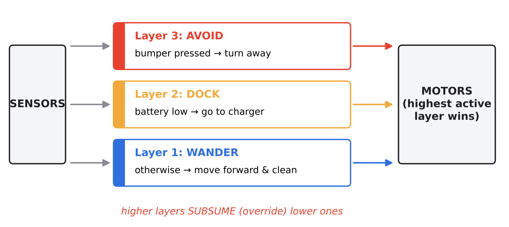
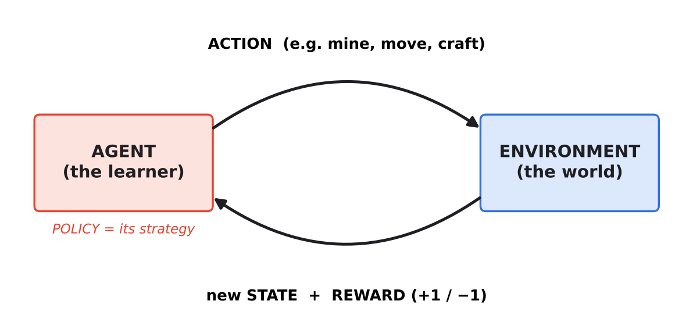
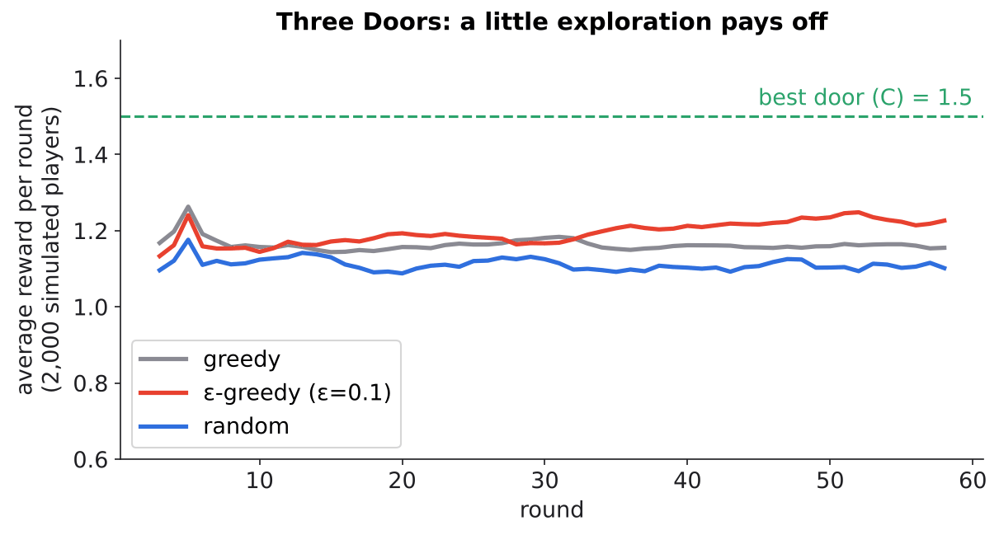
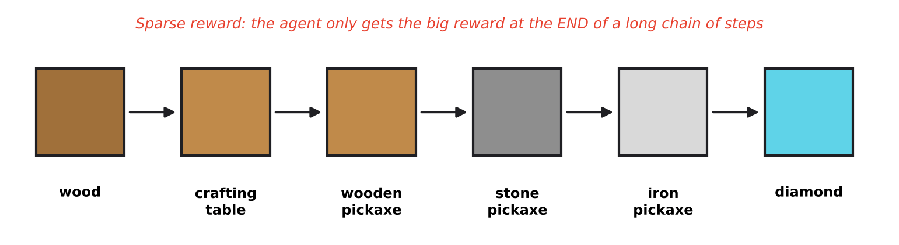
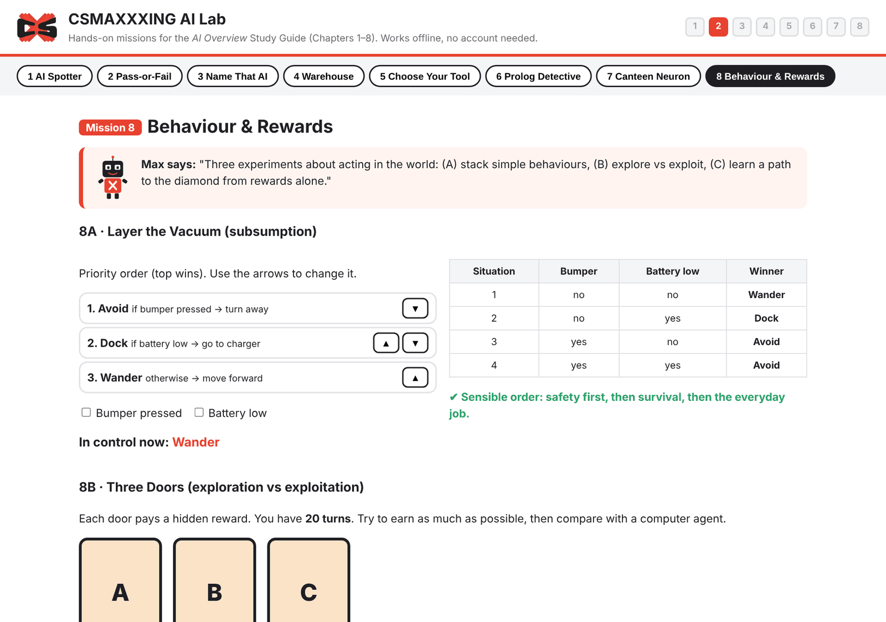
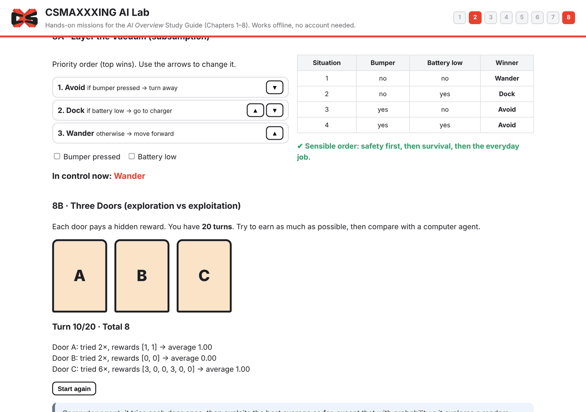
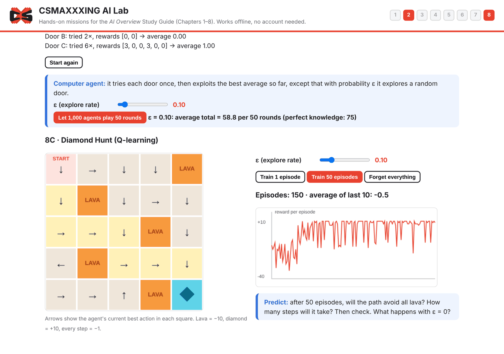

# 8. Behaviourist AI: Acting and Learning from Rewards {#ch8}

::: mission
**MISSION 8: From Vacuum to Diamonds.** Max now gets a body: first as a robot vacuum that must avoid furniture and find its charger, then as an explorer in a blocky mining world where the only prize is a diamond buried at the end of a long chain of steps. Nobody will give Max labelled answers. Your mission: discover how an agent can learn to act well just by **doing** and receiving **rewards**.
:::

**In this chapter you will:** build intelligent behaviour from simple layered rules · learn the vocabulary of reinforcement learning · experience the exploration–exploitation dilemma · watch an agent learn a path with Q-learning · understand how AI learned to find diamonds in Minecraft.

Chapter 8 has **two related ideas**: (1) **behaviour-based AI** builds intelligent action from layers of simple behaviours; (2) **reinforcement learning** learns good actions from rewards. Both focus on *acting in the world* rather than on stored knowledge (Chapter 6) or labelled examples (Chapter 7).

## 8.1 Behaviour-based AI and subsumption {#ch8-1}

In the 1980s, researchers found that symbolic AI worked badly in real robots: building a detailed internal model of the world was too slow and brittle. Rodney Brooks proposed a **reactive** approach instead: simple behaviours that respond to sensors directly (Moore, 2016). His **subsumption architecture** is a hierarchy of simple, rule-like behaviours; complex behaviour **emerges** from these simple parts interacting with the environment (Wooldridge, Parsons and Payne, 2018), and higher layers can take over (**subsume**) lower ones when needed (University of York, n.d.).

{width=85%}

Brooks went on to co-found iRobot, the company behind the Roomba robot vacuum. Critics point out that subsumption is hard to scale to very complex robots (Moore, 2016).

::: misconception
**MISCONCEPTION: "Behaviour-based means no rules."** Each behaviour *is* a simple rule. The difference from symbolic AI is that there is **no big model of the world** and no long chain of reasoning: just fast reactions, ranked by priority.
:::

## 8.2 Reinforcement learning: the vocabulary {#ch8-2}

In **reinforcement learning (RL)**, an **agent** learns by interacting with an **environment**. It observes the current **state**, takes an **action**, and the environment responds with a new state and a **reward** (positive) or penalty (negative). Over many attempts the agent improves its **policy**, its strategy for choosing actions, so as to earn more total reward (OVHcloud, n.d.; Verpex, 2025). Unlike supervised learning, nobody provides correct answers; the agent learns by **trial and error**.

{width=80%}

| Term | Meaning | Robot-vacuum example |
|---|---|---|
| Agent | The learner and decision-maker | The vacuum's control program |
| Environment | Everything the agent interacts with | The living room |
| State | The current situation | Position, battery level, dirt sensor |
| Action | A choice the agent can make | Forward, turn left, return to dock |
| Reward | Feedback number after an action | +1 for dirt collected, −5 for hitting a wall |
| Policy | The agent's learned strategy | "When the battery is low and the dock is to the left, turn left" |

Two challenges make RL hard:

- **Exploration vs exploitation:** should the agent **exploit** the best action it knows, or **explore** something new that might be better?
- **Delayed (sparse) rewards:** some actions pay off only much later, so the agent must work out which earlier actions deserve the credit (the *credit assignment* problem).

## 8.3 Exploration vs exploitation in action {#ch8-3}

Imagine three doors with hidden payouts. Door A always pays 1. Door B pays 5, but only on a die roll of six. Door C pays 3 on a roll of 4, 5 or 6.

::: example
**WORKED EXAMPLE: Expected (average) reward per turn.**
Door A: 1. Door B: 5 × 1/6 ≈ 0.83. Door C: 3 × 3/6 = **1.5**. So C is best on average, but if B happens to pay 5 on your first try, it *looks* best. An agent that stops exploring too early can get stuck on the wrong door.
:::

We simulated 2,000 players per strategy for 60 rounds (code: `activities/code/three_doors_bandit.py`):

{width=85%}

## 8.4 Q-learning: learning a path from rewards {#ch8-4}

**Q-learning** is a classic RL method. The agent keeps a table of **Q-values**: for every state and action, an estimate of how much future reward that action will bring. After each step it nudges the estimate toward:

> reward received now + 0.9 × (best Q-value of the next state)

The 0.9 (the *discount*) makes near rewards count a little more than distant ones. Repeated over many episodes, good actions near the goal pass their value back, step by step, to the start: that is how the agent solves **delayed rewards**.

## 8.5 The big finale: AI finds diamonds in Minecraft {#ch8-5}

Minecraft is a hard test for RL: every world is randomly generated, the agent sees only pixels, and getting a diamond requires a long chain of steps (collect wood, craft a table, make wooden, stone and iron pickaxes, then find and mine diamond), with almost no reward until the very end.

Two milestones use everything in this module:

| System | How it learned | Result |
|---|---|---|
| **OpenAI VPT** (2022) | First **watched about 70,000 hours of human Minecraft videos** (learning from data, Chapter 7), then was fine-tuned with **reinforcement learning**. | Learned to craft diamond tools, a task that can take skilled humans over 20 minutes (about 24,000 actions) (OpenAI, 2022). |
| **DeepMind DreamerV3** (2025, *Nature*) | **Reinforcement learning from scratch**, with no human data. It learns a **world model** and "imagines" the results of actions before taking them. | Described as the first algorithm to collect diamonds in Minecraft from scratch without human data or curricula (Hafner et al., 2025). |

Our Diamond Hunt grid is a tiny version of the same problem: an agent, an environment, actions, a reward only at the end, and a policy improved by trial and error.

::: misconception
**MISCONCEPTION: "If an AI can mine diamonds in Minecraft, it is general AI."** DreamerV3 is impressive and its creators see it as a step toward more general learning algorithms, but it is still trained for specific tasks in specific environments. It cannot write an essay or cook dinner. By Section 3.1, it is **Narrow AI**.
:::

## Lab 8A: Layer the Vacuum {#lab8a}

::: lab
**Goal:** see how priority between simple behaviours produces sensible, or silly, action.

**Open:** CSMAXXXING AI Lab → tab **8 Behaviour & Rewards** → section **8A**.

**Steps**

1. **Predict** which behaviour wins in each of the four situations (bumper yes/no × battery low yes/no), then check the table.
2. Use the ▲▼ buttons to **swap Avoid and Dock**. Predict what changes, then read the warning.
3. Move **Wander** to the top. What happens to the robot now?

**Reflect:** why must safety behaviours have the highest priority?
:::

## Lab 8B: Three Doors {#lab8b}

::: lab
**Goal:** experience exploration vs exploitation, then compare yourself with an RL agent.

**Open:** AI Lab tab 8 → section **8B**. *Code version:* `three_doors_bandit.py`. *Paper fallback:* one die and a partner who reads the payout rules from Section 8.3.

**Steps**

1. Play **20 turns** by clicking doors. Do **not** read Section 8.3's worked example first.
2. Write down when you decided which door was best, and how many times you tried each door.
3. Read the reveal. Did luck mislead you?
4. Set ε (explore rate) to **0**, press *Let 1,000 agents play*, and note the average. Repeat with ε = **0.1** and ε = **1**. **Predict** the ranking first.

**Reflect:** what is the risk of ε = 0? What is the cost of ε = 1?
:::

## Lab 8C: Diamond Hunt {#lab8c}

::: lab
**Goal:** watch Q-learning discover a safe, short path from rewards alone.

**Open:** AI Lab tab 8 → section **8C**. *Code version:* `diamond_hunt_qlearning.py` prints the learned policy as arrows.

**Steps**

1. **Predict:** after 50 training episodes, will the path avoid all lava? How many steps will the shortest path take? (Count on the grid.)
2. Press **Train 50 episodes** two or three times. Watch the arrows and the reward chart.
3. Press **Forget everything**, set ε = **0**, and train again. What goes wrong?
4. In the Python version, change the lava layout in `GRID`, predict the new path, and run it.

**Reflect:** link this lab to the five steps in Chapter 2. Which part of Q-learning is the *Adjustments* step?
:::

::: hint
**HINT for step 3:** with ε = 0 the agent always takes the action it currently thinks is best. At the very start all Q-values are 0, so what does it "think" is best?
:::

## Quick check 8 {#qc8}

1. In a subsumption robot, the Avoid layer and the Wander layer are both active. Which controls the motors, and why?
2. Name the six RL terms from the table in Section 8.2.
3. Why is getting a diamond in Minecraft a *sparse reward* problem?

## Key takeaways {#ch8-takeaways}

- **Behaviour-based AI:** layered simple behaviours; higher layers subsume lower ones; intelligence emerges from interaction.
- **RL:** agent, environment, state, action, reward, policy, learned by **trial and error**.
- Good agents balance **exploration** and **exploitation**.
- **Q-learning** passes reward back through states, solving delayed rewards step by step.
- Minecraft diamonds were reached by learning from human video plus RL (VPT, 2022), and then by RL from scratch with a world model (DreamerV3, 2025).

## Module wrap-up: Max's journey {#wrap-up}

Max began as a blank system that could not tell AI from a calculator. Max then learned the five steps (Ch. 2), learned that it is Narrow AI (Ch. 3), took jobs in vision, robotics and advice (Ch. 4), learned when *not* to use AI (Ch. 5), and tried three ways of being intelligent: **following rules** (Ch. 6), **learning from examples** (Ch. 7) and **learning from rewards** (Ch. 8). Real systems such as self-driving cars and Minecraft agents **combine** all three ideas.

**What next?** Test yourself with the **Test Bank**, revisit any Lab mission you have not completed (all 8 badges!), and explore the further resources below.

## Resources for Chapter 8 {#ch8-resources}

- **CSMAXXXING Video Tutorials, Chapter 8**: our Minecraft speedrun / reinforcement-learning video lecture, which connects the RL loop to a real speedrun.
- **Crash Course AI #9, "Reinforcement Learning"** (CrashCourse with PBS Digital Studios, 2019, about 11 minutes): <https://www.pbs.org/video/reinforcement-learning-9-t9yhid>. Around the 9-minute mark the video discusses exploration vs exploitation. *While watching:* which of your Three Doors choices were exploration and which were exploitation?
- **OpenAI, "Learning to play Minecraft with Video PreTraining"** (2022): <https://openai.com/index/vpt/>. A blog post with videos of the agent crafting tools.
- **DreamerV3 project page** (Hafner et al.): <https://danijar.com/project/dreamerv3/>. Videos of the diamond-collecting agent; the paper itself is advanced reading.

## Sources for Chapter 8 {#ch8-sources}

- Wooldridge, M., Parsons, S. and Payne, T. R. (2018). *COMP310 Chapter 5* (University of Liverpool lecture slides). <https://www.csc.liv.ac.uk/~trp/COMP310_files/COMP310%20Chapter5%202018.pdf>
- Moore, R. K. (2016). PCT and beyond: Towards a computational framework for "intelligent" communicative systems. arXiv:1611.05379. <https://arxiv.org/pdf/1611.05379>
- University of York (n.d.). *Rodney A. Brooks* (Susan Stepney's book pages). <https://www-users.cs.york.ac.uk/susan/books/pages/b/RodneyABrooks.htm>
- OVHcloud (n.d.). *What is reinforcement learning?* <https://www.ovhcloud.com/en-in/learn/what-is-reinforcement-learning/>
- Verpex (2025). *Reinforcement learning: How machines learn through rewards.* <https://verpex.com/blog/website-tips/what-is-reinforcement-learning>
- Baker, B. et al. (2022). Video PreTraining (VPT): Learning to act by watching unlabeled online videos. *NeurIPS 2022*. arXiv:2206.11795. Blog: <https://openai.com/index/vpt/>
- Hafner, D., Pasukonis, J., Ba, J. and Lillicrap, T. (2025). Mastering diverse control tasks through world models. *Nature.* <https://www.nature.com/articles/s41586-025-08744-2>

## Answers and feedback: Chapter 8 {#ch8-answers .answers}

**Lab 8A: Layer the Vacuum.** With the order Avoid > Dock > Wander: (no bump, battery fine) → Wander; (no bump, battery low) → Dock; (bump, battery fine) → Avoid; (bump, battery low) → **Avoid** (highest priority wins). Swapping Avoid and Dock: in situation 4 the robot drives toward the charger **into** the obstacle. Wander on top: Wander's condition is always true, so it always wins; the robot never avoids or docks. *Why safety first:* a crash can damage the robot or the furniture immediately; a low battery can wait a second.

**Lab 8B: Three Doors.** Average reward per turn: A = 1, B ≈ 0.83, **C = 1.5**. In our simulation (2,000 games of 50 rounds): greedy (ε = 0) ≈ 57.6 total, ε = 0.1 ≈ 59.4, random ≈ 55.2; perfect knowledge = 75. Your numbers in the Lab will vary slightly because the dice are random. *ε = 0 risk:* it can lock onto a door that got lucky early (often B) and never discover C. *ε = 1 cost:* it never uses what it has learned, so it averages the three doors (about 1.1 per turn).

**Lab 8C: Diamond Hunt.** Yes, after about 50–150 episodes the greedy path avoids all lava. The shortest path is **8 steps** (reward −7 + 10 = +3). Our run of `diamond_hunt_qlearning.py`: average reward in the first 20 episodes −20.85, in the last 20 episodes +1.45 (below +3 because the agent still explores 10% of the time). The learned path: (0,0) → (0,1) → (0,2) → (1,2) → (1,3) → (1,4) → (2,4) → (3,4) → (4,4). *With ε = 0:* all Q-values start at 0, so the agent keeps repeating whatever it tried first; it explores far less and may take much longer to find the diamond or keep repeating a bad route. *Link to Chapter 2:* the Q-value update (nudging the estimate toward reward + 0.9 × best next value) is the **Adjustments** step; the reward chart is the **Assessment**.

**Quick check 8**

1. **Avoid**: it is the higher layer, so it subsumes (overrides) Wander.
2. Agent, environment, state, action, reward, policy.
3. The agent gets the big reward only after a long sequence of correct steps (wood → table → pickaxes → iron → diamond), and almost no reward along the way, so it is hard to tell which earlier actions deserve credit.
